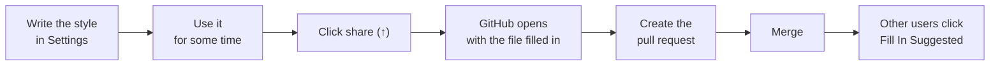

# App styles

An app style tells Pretype how to write in one app or on one website. It is one short plain-text file for each app.

All Pretype users who have that app can add your style with one click: **Settings → Personalization → Per-app style → Fill In Suggested**. A style changes the reply drafts (<kbd>⌥⇧Tab</kbd>) in all completion styles. It also changes the completions, but only in Instruct style.



## Share yours

From the app (the easy way):

1. Write the style for your app in **Settings → Personalization → Per-app style**.
2. Use the style for some time.
3. Click the share button (↑) next to the style. GitHub opens with the file filled in.
4. Click **Propose new file**.
5. Click **Create pull request**. GitHub makes the fork for you.

By hand:

1. Add a file. The table shows the name and the location.
2. Open a pull request.

| What | Where |
|---|---|
| A Mac app | `apps/<bundle id>.txt`, for example `apps/com.tinyspeck.slackmacgap.txt` |
| A website | `sites/<host>.txt`, for example `sites/mail.google.com.txt` (no `www.`) |

To get the bundle ID of an app, run `osascript -e 'id of app "Slack"'`. You can also add the app to the per-app list in Pretype and hover over its name. Write the file name in lowercase.

A site file also applies to the subdomains of that host. For example, `sites/google.com.txt` applies on mail.google.com. On a site, the site style replaces the style of the browser.

## The file

```
# Slack
This is work chat: short, direct messages in a friendly professional tone.
Contractions are fine. Skip greetings and sign-offs. Emoji only when it adds meaning.
```

Lines that start with `#` are comments. Put the app name there, and all information that a reviewer must know. All other lines are the style.

**Rules for a good style:**

| Rule | Reason or example |
|---|---|
| Write in **English**, also for apps where you write in a different language. | The style controls the tone, not the language. The models follow English instructions best. |
| Write **about the type of text in the app**, not about you: register, length, greetings, emoji, format habits. | Good: "Commit messages: imperative mood, under 72 characters". Bad: "I'm a backend developer at Acme". |
| Keep it **short**: less than 400 characters. | The style goes into each prompt. |
| Put **nothing personal** in it. | No names, employers, addresses, or signatures. |

The pull request checks fail if the file name is wrong, if the style is empty, or if the style is longer than the limit.
