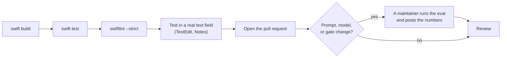

# Contributing to Pretype

Thank you for your help with Pretype. Pretype is an open-source project in an early stage. We accept all types of contributions: bug reports, fixes, new engines, prompt and quality work, and documentation.

## The easiest contribution: a style for your app

You do not need Swift for this contribution. A style tells Pretype how people write in an app or on a website, for example Slack, Linear, or Gmail. A style is one short text file in [`AppStyles/`](AppStyles/README.md).

To share a style, do one of these:

* Add a file to [`AppStyles/`](AppStyles/README.md) and open a pull request.
* Click the share button next to the style in **Settings → Personalization → Per-app style**. GitHub opens with the pull request filled in.

All users of that app can then add your style with one click.

## Ground rules

* Be respectful. This project follows the [Code of Conduct](CODE_OF_CONDUCT.md).
* Report security issues through [SECURITY.md](SECURITY.md). Do **not** open public issues for them.
* Keep each pull request on one logical change. Use the style of the code near your change.

## Development setup

The requirements are the same as for *Build from source* in the README.

| Item | Requirement | Reason |
|---|---|---|
| Mac | Apple Silicon | MLX does not operate on Intel Macs. |
| Xcode | **Full Xcode 26.4 or newer**. Command Line Tools alone are not sufficient. | The MLX packages need Swift 6.3. Older toolchains also fail to compile the MLX dependencies. |
| SDK | The macOS 26 SDK | `FoundationModelsEngine` imports the `FoundationModels` framework. Xcode 16.x does not have this framework. |
| Metal | The Metal shader compiler | The MLX engine needs it. |

macOS 26 is the minimum runtime version of the app. CI builds on macOS 26.

To build and run the app:

1. Install the Metal toolchain. Do this one time only.
   ```bash
   xcodebuild -downloadComponent MetalToolchain
   ```
2. Build a real `.app` bundle. The bundle gets its own Accessibility permission.
   ```bash
   ./Scripts/make-app.sh
   ```
3. Open the app.
   ```bash
   open build/Pretype.app
   ```

For a fast inner loop:

1. Run `./Scripts/make-app.sh` one time. This step makes the MLX metallib.
2. Run `./Scripts/dev.sh`. This script runs `swift build` and copies the MLX metallib next to the dev binary.

Plain `swift build` compiles the app, but MLX cannot run from a SwiftPM binary. Pretype finds that the shaders are missing and disables the MLX engine. It does not crash.

> **Permissions.** Pretype needs these permissions:
>
> | Permission | When |
> |---|---|
> | Accessibility | Always |
> | Screen Recording | Only for OCR screen context |
> | Microphone | Only for dictation |
>
> If you have an *Apple Development* certificate, `make-app.sh` signs with it. Then the permissions stay after each rebuild. If you do not have one, the script uses an ad-hoc signature. Then you must grant the permissions again after each rebuild:
> `tccutil reset Accessibility app.pretype.Pretype`. See [Troubleshooting](docs/troubleshooting.md).

## Diagnostic flags

The app binary has two diagnostic flags. With a flag, the binary prints to the terminal and does not start the app.

| Flag | What it does |
|---|---|
| `--ax-probe` | Prints what Accessibility shows for the focused text field: the role, the caret position and the caret rectangle. It prints every 0.8 seconds for 25 seconds. Use it when the suggestion shows at the wrong position in an app, for example in an Electron app. |
| `--dictation-probe` | Prints the dictation settings and status one time. Then it prints each change of a modifier key, with the hold state that the change caused. When a hold completes, it prints each condition that a capture checks. Use it when the dictation key does nothing. The probe only observes. It does not record and does not type. |

Run a flag on the built app bundle:

```bash
./build/Pretype.app/Contents/MacOS/Pretype --ax-probe
./build/Pretype.app/Contents/MacOS/Pretype --dictation-probe
```

Both probes need the Accessibility permission. If the binary does not have it, `--ax-probe` shows the system prompt and stops. Grant the permission, then run the probe again.

> **NOTE:** Run from a terminal, `--dictation-probe` shows the microphone permission of the terminal, not of Pretype. To see the permission of Pretype, open the Pretype menu and read **Diagnostics → Dictation**.

The quality CLI and the eval harness are not in the repository. See *Quality eval* below.

## Quality eval — please measure prompt/model changes

Measure each change to prompting, sampling, the output gates, or the model catalog. Measure before the change and after it.

The eval harness is in the git-ignored `dev-tools/` tree. Thus external contributors cannot run it. This is expected. Open the pull request, and write in it that the change needs an eval run. A maintainer runs the eval before and after the change. The maintainer posts these numbers on the pull request: coverage, first-word accuracy, saved characters, and p50 latency.

The eval is a tool for **comparison**. The absolute first-word accuracy is lower than the real quality, because the eval rejects valid paraphrases.

## Code style

* Use the style of the code near your change: 4-space indentation, no trailing whitespace.
* CI runs SwiftLint (`swiftlint --strict`, configuration in `.swiftlint.yml`). If you have SwiftLint, run `swiftlint --strict` before you push.
* Comments tell *why*, not *what*. The codebase uses short comments with much information. For examples, see the output-gate comments in `Engines/CompletionGates.swift` and `Engines/CorrectionGates.swift`.
* Do not add dependencies before you discuss them in an issue.

## Translations

The interface is in English and Russian. The strings are in `Localization/Localizable.xcstrings`, a String Catalog. The English text in the code is the key.

* Write each string that the user sees as a SwiftUI literal (`Text("…")`, `.help("…")`) or as `String(localized: "…")`. Keep a full sentence in one string. Do not join parts of a sentence with `+`.
* Do not localize prompts, log lines, identifiers, or defaults keys.
* After you add or change strings, run `Scripts/sync-strings.py`. The script adds the new keys to the catalog, marks removed keys as stale, and shows the untranslated keys.
* To translate, open the catalog in Xcode, or edit the JSON.
* To add a language, add its translations to the catalog. `Scripts/make-app.sh` compiles each language into the app, and **Settings → General → Language** shows it.

## Add an engine

1. Make the engine conform to the `CompletionEngine` protocol (`Sources/Pretype/Engines/CompletionEngine.swift`).
2. Implement `complete(_:)`. You can also implement `correct(selection:request:)`.
3. Use the shared output gates through `CompletionGates.postProcess(...)`.
4. Report the progress through `EngineState`. Then the menu and the caret indicator show the correct state.

`FoundationModelsEngine.swift` is a compact reference implementation.

## Pull request checklist



- [ ] `swift build` and `swift test` pass, and `swiftlint --strict` shows no problems. CI runs all three.
- [ ] The app starts, and the change operates in a real text field. TextEdit and Notes have the best Accessibility support.
- [ ] For prompt, model, or gate changes: you asked for eval numbers. A maintainer runs the harness. See *Quality eval* above.
- [ ] The diff contains only the change. Comments explain the decisions that are not obvious.
