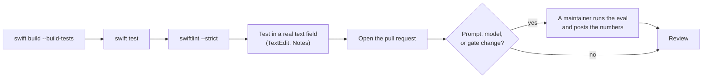

# Contributing to Pretype

Thank you for your help with Pretype. Pretype is an open-source project in an early stage. We accept all types of contributions: bug reports, fixes, new engines, prompt and quality work, and documentation.

## The easiest contribution: a style for your app

You do not need Swift for this contribution. A style tells Pretype how people write in an app or on a website, for example Slack, Linear, or Gmail. A style is one short text file in [`AppStyles/`](AppStyles/README.md).

To share a style, do one of these:

* Add a file to [`AppStyles/`](AppStyles/README.md) and open a pull request.
* Click the share button next to the style in **Settings → Personalization → Per-app style**. GitHub opens with the pull request filled in.

All users of that app can then add your style with one click.

## Ground rules

* Be respectful. This project follows the [Code of Conduct](CODE_OF_CONDUCT.md).
* Report security issues through [SECURITY.md](SECURITY.md). Do **not** open public issues for them.
* Keep each pull request on one logical change. Use the style of the code near your change.

## Development setup

| Item | Requirement | Reason |
|---|---|---|
| Mac | Apple Silicon | MLX does not operate on Intel Macs. |
| Xcode | **Full Xcode 26.4 or newer**. Command Line Tools alone are not sufficient. | The MLX packages need Swift 6.3. Older toolchains also fail to compile the MLX dependencies. |
| SDK | The macOS 26 SDK | `FoundationModelsEngine` imports the `FoundationModels` framework. Xcode 16.x does not have this framework. |
| Metal | The Metal shader compiler | The MLX engine needs it. |

macOS 26 is the minimum runtime version of the app. CI builds on macOS 26.

To build and run the app:

1. Install the Metal toolchain. Do this one time only.
   ```bash
   xcodebuild -downloadComponent MetalToolchain
   ```
2. Build a real `.app` bundle. The bundle gets its own Accessibility permission.
   ```bash
   ./Scripts/make-app.sh
   ```
3. Open the app.
   ```bash
   open build/Pretype.app
   ```

For a fast inner loop:

* Run `./Scripts/dev.sh`. This script runs `swift build`, puts the per-app styles and the translations next to the binary, and starts it.

`swift build` also compiles the Metal shaders of MLX. For this, Xcode needs the Metal Toolchain component (`xcodebuild -downloadComponent MetalToolchain`). If the shaders are missing, Pretype disables the MLX engine. It does not crash.

> **Permissions.** Pretype needs these permissions:
>
> | Permission | When |
> |---|---|
> | Accessibility | Always |
> | Screen Recording | Only for OCR screen context |
> | Microphone | Only for dictation |
>
> If you have an *Apple Development* certificate, `make-app.sh` signs with it. Then the permissions stay after each rebuild. If you do not have one, the script uses an ad-hoc signature. Then you must grant the permissions again after each rebuild:
> `tccutil reset Accessibility app.pretype.Pretype`. See [Troubleshooting](docs/troubleshooting.md).

## Diagnostic flags

The app binary has two diagnostic flags. With a flag, the binary prints to the terminal and does not start the app.

| Flag | What it does |
|---|---|
| `--ax-probe` | Prints what Accessibility shows for the focused text field: the role, the caret position and the caret rectangle. It prints every 0.8 seconds for 25 seconds. Use it when the suggestion shows at the wrong position in an app, for example in an Electron app. |
| `--dictation-probe` | Prints each change of a modifier key, with the hold state that the change caused. Use it when the dictation key does nothing. The probe only observes. It does not record and does not type. |

Run a flag on the built app bundle:

```bash
./build/Pretype.app/Contents/MacOS/Pretype --ax-probe
./build/Pretype.app/Contents/MacOS/Pretype --dictation-probe
```

Both probes need the Accessibility permission. If the binary does not have it, `--ax-probe` shows the system prompt and stops. Grant the permission, then run the probe again.

> **NOTE:** The dictation settings and the microphone permission are not in the probe. Open the Pretype menu and read **Diagnostics → Dictation**. A binary that you start from a terminal gets the microphone permission of the terminal, not of Pretype.

The quality CLI and the eval harness are not in the repository. See *Quality eval* below.

## Quality eval — please measure prompt/model changes

Measure each change to prompting, sampling, the output gates, or the model catalog. Measure before the change and after it.

The eval harness is in the git-ignored `dev-tools/` tree. Thus external contributors cannot run it. This is expected. Open the pull request, and write in it that the change needs an eval run. A maintainer runs the eval before and after the change. The maintainer posts these numbers on the pull request: coverage, first-word accuracy, saved characters, and p50 latency.

The eval is a tool for **comparison**. The absolute first-word accuracy is lower than the real quality, because the eval rejects valid paraphrases.

## Code style

* Use the style of the code near your change: 4-space indentation, no trailing whitespace.
* CI runs SwiftLint (`swiftlint --strict`, configuration in `.swiftlint.yml`). If you have SwiftLint, run `swiftlint --strict` before you push.
* Comments tell *why*, not *what*. The codebase uses short comments with much information. For examples, see the output-gate comments in `Engines/CompletionGates.swift` and `Engines/CorrectionGates.swift`.
* Do not add dependencies before you discuss them in an issue.

## Write tests

Each test process is isolated. `Settings` writes to a private defaults file, API keys stay in memory, and the Hugging Face cache is an empty scratch folder. Thus a test never changes your own settings, keys or downloads.

* **Pipeline.** Subclass `PipelineTestCase`. It drives a real `SuggestionController` against `FakeWorld` (`PipelineTestSupport.swift`): fake fields, keys, clipboard, clock and bookings. Use `set(\.someSetting, value)` for a setting; the test puts it back.
* **Engines.** Subclass `MLXTestCase`. It runs MLX on the CPU. It skips when the Mac has no Metal device or the build has no compiled shaders. On CI, missing shaders fail the test. `tinyContainer()` and `TinyGemma` give a tiny synthetic Gemma, so no test downloads a model. Use `withScratchHub` when a test writes model folders.
* **Rules.** Test pure types directly: for example `FieldState`, `RequestGate`, `keyAction`, `RereadSchedule`, `ModelCatalog` and the output gates.
* Assert what the user sees or what the app types, not internal state. A good test fails when you break the rule it names.

## Translations

The interface is in 18 languages: English (the source) and cs, da, de, es, fr, it, ja, ko, nl, pl, pt-BR, ro, ru, sv, tr, uk and zh-Hans. The strings are in `Localization/Localizable.xcstrings`, a String Catalog. The English text in the code is the key.

* Write each string that the user sees as a SwiftUI literal (`Text("…")`, `.help("…")`) or as `String(localized: "…")`. Keep a full sentence in one string. Do not join parts of a sentence with `+`.
* Do not localize prompts, log lines, identifiers, or defaults keys.
* After you add or change strings, run `Scripts/sync-strings.py`. The script adds the new keys to the catalog. It marks removed keys as stale, or deletes them if they have no translations. Then it shows the untranslated keys.
* To translate, open the catalog in Xcode, or edit the JSON.
* CI runs `Scripts/sync-strings.py --check`. The check fails if a key has no translation in one of the languages of the catalog.
* If you cannot translate a new string, write this in the pull request. The strings check in CI then fails. This is expected: the maintainer adds the missing translations before the merge.
* To add a language, add its translations to the catalog. `Scripts/make-app.sh` compiles each language into the app, and **Settings → General → Language** shows it.

## Add an engine

1. Make the engine conform to the `CompletionEngine` protocol (`Sources/Pretype/Engines/CompletionEngine.swift`).
2. Implement the members that have no default: `name`, `state`, `statusLine`, `complete(_:)`, `correct(selection:redactLog:)`, `reply(to:request:)`, `rewrite(selection:instruction:)` and `updateCompletion(length:instructions:)`. An engine that cannot reply or rewrite can return `nil`. An engine that cannot run a fix must throw `EngineNotReady`: for `correct`, `nil` means "nothing to fix", and the user sees "✓ looks fine". The protocol extension supplies the other members. Override `completions(for:)` if the engine can stream.
3. Use the shared output gates through `CompletionGates.postProcess(...)`.
4. Report the progress through `EngineState`. Then the menu and the caret indicator show the correct state.

`FoundationModelsEngine.swift` is a compact reference implementation.

## Pull request checklist



- [ ] `swift build --build-tests` and `swift test` pass, and `swiftlint --strict` shows no problems. If you changed text that the user sees, you ran `Scripts/sync-strings.py`. CI runs all of these checks. The strings check fails only on translations you could not write: say so in the pull request (see *Translations*).
- [ ] The app starts, and the change operates in a real text field. TextEdit and Notes have the best Accessibility support.
- [ ] For prompt, model, or gate changes: you asked for eval numbers. A maintainer runs the harness. See *Quality eval* above.
- [ ] The diff contains only the change. Comments explain the decisions that are not obvious.
