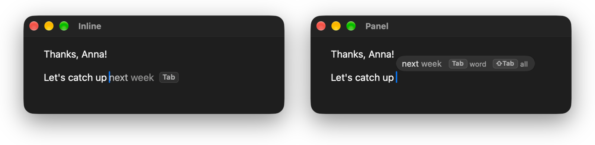
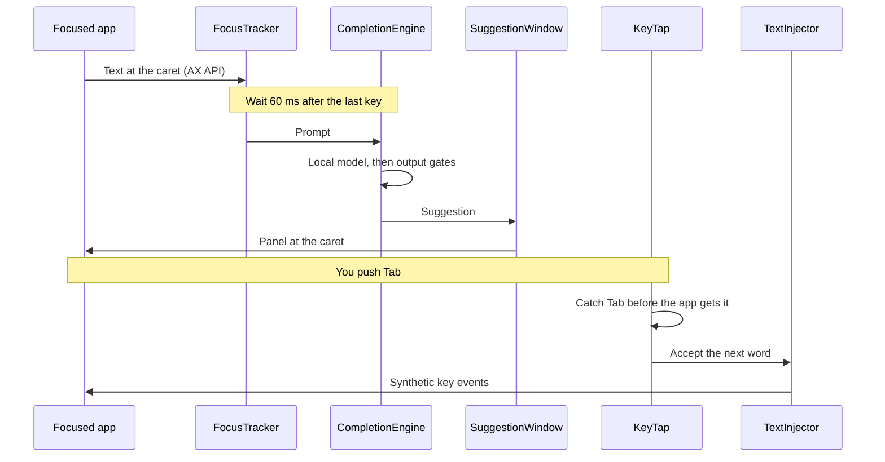

<div align="center">

<picture>
  <source media="(prefers-color-scheme: dark)" srcset="docs/pretype-logo-dark.png" />
  
</picture>

# Pretype

**System-wide AI autocomplete for macOS.**<br/>
Pretype shows a suggestion at the caret in each text field. A local model makes it. Your text stays on your Mac.

[](https://github.com/nikiomori/Pretype/releases/latest)
[](https://github.com/nikiomori/Pretype/actions/workflows/ci.yml)
[](LICENSE)
[](#requirements)
[](https://pretype.app)

<p>
  <a href="#features"><b>Features</b></a> ·
  <a href="#quick-start"><b>Quick Start</b></a> ·
  <a href="docs/models.md"><b>Models</b></a> ·
  <a href="docs/privacy.md"><b>Privacy</b></a> ·
  <a href="docs/troubleshooting.md#faq"><b>FAQ</b></a>
</p>

<a href="https://github.com/nikiomori/Pretype/releases/latest/download/Pretype.app.zip">
  
</a>

<br/><br/>


<sub>*You type. The local model makes a suggestion. <kbd>Tab</kbd> accepts one word. <kbd>⇧Tab</kbd> accepts all of it.*</sub>

</div>

---

> [!IMPORTANT]
> **What Pretype must have, and what goes off your Mac.**
> Pretype must have the **Accessibility** permission. A keylogger asks for the same permission. Pretype uses it for three tasks: to read the focused text field, to catch the accept key, and to type the suggestion.
>
> Pretype does not upload the text that you type. A local model makes all suggestions. The app uses the network only for the downloads and the version check in the diagram below.

<div align="center">

</div>

| Connection | What Pretype gets | When |
|---|---|---|
| Hugging Face | Model weights | At the first launch. On some models, also an instruct sibling at the first fix chord. One time, in the background, the current build of a model that an older install downloaded. |
| Apple servers | The on-device speech model | When you enable dictation |
| Hugging Face | The Parakeet speech model | Only if you select Parakeet |
| GitHub Releases API | The latest version number. Pretype sends no data about you. | One time each day. You can disable it in **Settings → General**. |

Do not trust these statements without proof. Three files contain all of the input path. Read them:

| File | Job |
|---|---|
| [`AXText.swift`](Sources/Pretype/AXText.swift) | Reads the text field |
| [`KeyTap.swift`](Sources/Pretype/KeyTap.swift) | Catches the accept key |
| [`TextInjector.swift`](Sources/Pretype/TextInjector.swift) | Types the suggestion into the field |

[Privacy & permissions](docs/privacy.md) gives the full list of connections. It also lists all data that the app keeps on disk, and it tells you how to remove all of it.

## Why Pretype?

Most autocomplete tools operate in one editor only, and they send your text to a server. Pretype operates in all macOS text fields, for example Mail, Slack, Notes, Safari, and VS Code. Your text stays on your Mac. You do not need an account, a subscription, or an API key.

Pretype is free and has the MIT license. It is an alternative to [Cotypist](https://cotypist.app). We wrote Pretype from the start with the same idea. Pretype has no connection with Cotypist.

---

## Features

### Keys

| Key | Action | Note |
|---|---|---|
| <kbd>Tab</kbd> | Accept the next word of the suggestion. | The part that one <kbd>Tab</kbd> accepts shows brighter. With no suggestion on the screen, <kbd>Tab</kbd> operates as usual. You can change the accept key to <kbd>⌘Space</kbd>, <kbd>⌥Space</kbd>, or <kbd>⌃Space</kbd> in Settings. |
| <kbd>⇧Tab</kbd> | Accept all of the suggestion. | |
| *(continue to type)* | Reject the suggestion. | |
| <kbd>Tab</kbd> on a pill | Apply a typo fix, an emoji, or an arithmetic result. | |
| <kbd>⌥Tab</kbd> | Fix the selected text. With no selection, fix the last word that you typed. | You see a preview first. |
| <kbd>⌥⇧Tab</kbd>, or a double-tap on a modifier | Write a draft of your next message from the conversation on the screen. | |
| <kbd>⏎</kbd> | Accept the rewrite in the preview. | |
| <kbd>Esc</kbd> | Remove a typo fix. Keep your original text instead of a rewrite. | <kbd>Esc</kbd> also discards a hands-free dictation. |
| Hold <kbd>⌥</kbd> | Dictate while you hold the key. | macOS 26 or later. Off by default. |
| <kbd>⌃⌥D</kbd> | Start hands-free dictation. Push the chord again to stop. | macOS 26 or later. Off by default. |

### What Pretype does

| Feature | What it does |
|---|---|
| **All text fields** | Operates in native AppKit and SwiftUI apps, in Electron apps (VS Code, Slack, Claude Desktop), and in web views. |
| **Panel at the caret** | Shows the suggestion in a floating panel at the caret. The panel does not cover your text. You can read it on all backgrounds. Inline ghost text is an unstable option: it uses the baseline and the font of the field. |
| **Typo fixes** | Shows a correction pill above a misspelled word. The macOS spell checker finds the error, in the language that it detects in the text near the word. |
| **Emoji shortcodes** | Type `:shrug:`, and the pill shows 🤷. Pretype knows some Gemoji names and all Unicode character names that macOS knows, for example `:rocket:` and `:thinking_face:`. It does not ship its own table. |
| **Arithmetic** | Type a sum that ends with `=`, for example `12*7=` or `(1+2)*3 =`. The pill shows the result. |
| **Rewrites** (<kbd>⌥Tab</kbd>) | The local model fixes grammar, typos, and phrasing in place. It keeps your tone. |
| **Reply drafts** (<kbd>⌥⇧Tab</kbd>) | The local model writes a draft of your next message from the conversation on the screen. |
| **Speed** | Warm suggestions take 49–145 ms on the local models. Pretype calculates only the new tokens and uses the KV cache again. |
| **Your style** | You can set one persona and a style instruction for each app. Pretype learns from a local journal. You can clear the journal or disable it at any time. |
| **Shared app styles** | The community shares styles for each app. One click adds the styles for the apps on your Mac. To share your style, add [one text file](AppStyles/README.md) or use the share button in Settings. |

Rewrites and reply drafts have measurements for each model. The best model fixes 69% of noisy lines exactly, and it writes a usable reply 97% of the time. [Choosing a model](docs/models.md#fixing-and-replying) has the table.

> [!NOTE]
> On some models, rewrites and reply drafts use a separate *instruct sibling*. Pretype downloads it one time, at the first use. The size is ≈1.6 GB on Qwen3.5, ≈2.2 GB on MiniCPM5, up to ≈5 GB on a Gemma in Base style. During the download, the menu bar shows *preparing…*.

### Where Pretype operates

* Pretype changes its style for each app and each website. For example, Gmail and Slack in the same browser can have different styles.
* You can disable Pretype for one app or one website from the menu.
* Pretype does not operate in password managers or in the shell.
* In a terminal, Pretype completes only the prompts that you type to an AI agent, for example Claude Code. This applies to Terminal, iTerm2, and the VS Code terminal.
* Pretype stops all reading while macOS reports secure input.
* **Pause on Battery** in the menu stops suggestions while the Mac is not connected to power.
* If you almost never accept the suggestions in an app, Pretype stops in that app. The menu shows the numbers and a **Resume** item.
* Optional on-screen OCR adds the text near the field as context.

### Dictation *(macOS 26 or later, off by default)*

Pretype types what you say into the current text field.

* Hold <kbd>⌥</kbd> and say a sentence. Then release the key.
* For longer text, use the hands-free chord <kbd>⌃⌥D</kbd>. Push it one time to start and one time to stop. You can scroll and click during the capture.
* The chord starts the recording at the keypress, not half a second later. No other function on the system uses this chord.
* If a hands-free capture gets no speech for a few seconds, it types the text that it has and stops. Thus a capture that you forget does not keep the microphone open.
* The speech models of macOS do the transcription on your Mac. Pretype does not download them from its own servers. Audio does not go to the disk or to the network.

| Language | Speech model | Punctuation |
|---|---|---|
| 30 locales: English, German, Spanish, French, Italian, Japanese, Korean, Portuguese, Cantonese, Chinese | Apple `SpeechTranscriber` (the newer model) | Yes |
| All other languages, **Russian included** | Apple `DictationTranscriber`: the model of the macOS dictation key. It is older and less accurate. | No |
| Opt-in, for the languages in the row above | **Parakeet**: the open 0.6B speech model from NVIDIA, with the Ultra post-training from moondream. It runs on the Neural Engine. One download of ~610 MB. | Yes. On Russian, it makes less than half the word errors of the system model: 5.4% WER against 12.6% on FLEURS. |

* **Tidy-up.** The transcript goes through the same minimal-edit fix that <kbd>⌥Tab</kbd> uses. This pass adds the punctuation and the capital letters that speech does not give.
* On models that use an instruct sibling, the tidy-up needs the same one-time download as <kbd>⌥Tab</kbd>. Dictation does not wait for it. Pretype types the text as it heard it, and downloads the sibling in the background on an unmetered network. The tidy-up starts when the download is complete.
* **Language.** Dictation uses the language of your keyboard layout. When you change the layout, the dictation language changes too.
* **Hints.** Pretype gives the names and the terms in the field to the recognizer. Thus the recognizer spells them as the page does.
* **Voice commands.** Enable them in **Settings → General → Dictation**. Then, if you dictate while text is selected, Pretype uses your words as an instruction. Examples: *"make it shorter"*, *"more formal"*, *"translate to English"*. You see a preview, as for a <kbd>⌥Tab</kbd> fix.
* **Focus change.** If the focus changes during a capture, Pretype puts the transcript on the clipboard. You do not lose it.

[Architecture → Dictation](docs/ARCHITECTURE.md#dictation) gives the details.

---

## Quick Start

Pretype operates only on Apple Silicon (M1 or newer). MLX does not operate on Intel Macs.

### Install with Homebrew *(recommended)*

```bash
brew install nikiomori/tap/pretype
```

Then do the steps in [First launch](#first-launch).

### Install from the download

1. Download [`Pretype.app.zip`](https://github.com/nikiomori/Pretype/releases/latest/download/Pretype.app.zip) from [Releases](https://github.com/nikiomori/Pretype/releases).
2. Unzip the file.
3. Move `Pretype.app` to `/Applications`.

Releases have a Developer ID signature, and Apple notarizes them. Thus macOS opens Pretype as it opens all other downloaded apps.

> [!NOTE]
> If you update from 2.4.0 or earlier, macOS asks for the Accessibility permission one more time. Those versions had an ad-hoc signature, and the signature is now different. Later updates keep the permission.

### First launch

1. Open Pretype.
2. Grant the **Accessibility** permission when macOS asks for it. If you grant it after the launch, restart Pretype.
3. Wait for the model download to complete. The menu-bar icon shows the progress.
4. Click the Pretype icon in the menu bar. The menu shows the status, **Diagnostics**, and **Settings…** (<kbd>⌘,</kbd>).

At the first launch, Pretype downloads one model from Hugging Face: **≈1–5.7 GB**. The size depends on the memory of your Mac. Pretype selects the strongest model that uses about a quarter of the memory.

To use a different model, select it in **Settings → Model**. [Choosing a model](docs/models.md) gives the eval numbers for the default.

Pretype has no Dock icon and no main window. It operates from the **menu bar** only.

### Build from source

> [!NOTE]
> You must have **full Xcode 26.4 or newer**. Command Line Tools alone are not sufficient. The prebuilt app does not need these tools.
> * The MLX packages need Swift 6.3.
> * The Apple Intelligence engine imports the `FoundationModels` framework. Xcode 16.x does not have this framework.
> * The MLX engine needs the Metal compiler.

1. Install the Metal toolchain. Do this one time only.
   ```bash
   xcodebuild -downloadComponent MetalToolchain
   ```
2. Clone the repository.
   ```bash
   git clone https://github.com/nikiomori/Pretype.git
   cd Pretype
   ```
3. Build the app. The script writes `build/Pretype.app`.
   ```bash
   ./Scripts/make-app.sh
   ```
4. Open the app.
   ```bash
   open build/Pretype.app
   ```

The [Contributing Guide](CONTRIBUTING.md#development-setup) gives the development loop, the headless harnesses, and the limits of SwiftPM with Metal.

---

## In Action

<div align="center">


<p><sub><i><b>Inline typo fix.</b> <kbd>Tab</kbd> applies the fix. <kbd>Esc</kbd> removes it.</i></sub></p>

<br/>


<p><sub><i><b>Rewrite (<kbd>⌥Tab</kbd>).</b> <kbd>⏎</kbd> accepts the rewrite. <kbd>Esc</kbd> keeps your original text.</i></sub></p>

<br/>


<p><sub><i><b>Two presentation modes.</b> The panel is the default. Inline ghost text is unstable: it can leave drawing errors on the screen.</i></sub></p>

<br/>


<p><sub><i><b>Settings show their cost.</b> Hover over an option. The meters for accuracy, speed, memory, and compute show the change before you apply it.</i></sub></p>

<br/>


<p><sub><i><b>Your style, for each app.</b> Formal text in Mail, short replies in Messages.</i></sub></p>

</div>

---

## How It Works



1. **FocusTracker** follows the focused text element with `AXObserver`. At each keystroke, it reads the text near the caret.
2. **SuggestionController** waits 60 ms after the last keystroke. Then it sends the text to the **CompletionEngine**: a local MLX model or Apple Intelligence. The output gates check the result. The engine gives a short continuation, or no suggestion. A new keystroke cancels the request that is in progress.
3. **SuggestionWindow** shows the suggestion in a panel at the caret. Inline ghost text is an unstable option.
4. A **CGEventTap** in `KeyTap` catches the accept key. When you accept the suggestion, **TextInjector** types it into the app with synthetic key events.

### Terms

| Term | Meaning |
|---|---|
| Suggestion | The text that Pretype offers at the caret. |
| Panel | The floating box that shows the suggestion. This is the default presentation. |
| Inline ghost text | The unstable presentation: gray text on the line, in the font of the field. |
| Accept key | The key that accepts a suggestion. The default is <kbd>Tab</kbd>. |
| Pill | The small box above a word that shows a typo fix, an emoji, or an arithmetic result. |
| Fix chord, reply chord | <kbd>⌥Tab</kbd> and <kbd>⌥⇧Tab</kbd>. |
| Instruct sibling | A second, instruction-tuned build of your model. Some models use it for fixes, replies, and the dictation tidy-up. |
| Journal | The local record of the suggestions that you saw and what you did with them. Pretype uses it for personalization. |

---

## Documentation

You can read the documentation at **[pretype.app/docs](https://pretype.app/docs)**. The source is in [`docs/`](docs/).

| Page | Contents |
|---|---|
| [**Architecture**](docs/ARCHITECTURE.md) | The engines, the model catalog, the quantization tiers, the KV cache, and how the app decides to show no suggestion |
| [**Choosing a model**](docs/models.md) | The eval for the defaults, the RAM and latency of each tier, and how to select a model for your languages |
| [**Privacy & permissions**](docs/privacy.md) | Each permission and why Pretype needs it, the data on disk, and how to remove all of it |
| [**Troubleshooting & FAQ**](docs/troubleshooting.md) | How to read Diagnostics, the usual problems, and the frequent questions |

---

## Requirements

| Item | Requirement |
|---|---|
| **OS** | macOS 14 or later. The Apple Intelligence engine needs macOS 26 or later. |
| **Hardware** | Apple Silicon (M1 or newer). Intel Macs cannot run MLX. |
| **Memory** | 8 GB is sufficient. The default model uses about a quarter of the memory of your Mac. It is ≈1.1 GB resident on 8 GB Macs, up to ≈5.6 GB from 32 GB. The catalog goes down to ≈1 GB. On Macs with much memory, you can select Gemma 4 E4B 8-bit (a ≈6 GB download). |
| **Storage** | ≈1–5.7 GB for the default model (the size depends on your Mac). ≈1–6 GB for the other models. |
| **Storage for <kbd>⌥Tab</kbd>** | Some models add a one-time instruct sibling: ≈1.6 GB on Qwen3.5, ≈2.2 GB on MiniCPM5, up to ≈5 GB on a Gemma in Base style. Qwen3.5 completes on its Base build, and it fixes and replies on the post-trained build. There is no sibling on Bonsai, because it fixes with itself. There is no sibling on a Gemma in its recommended Instruct style. |
| **To build** | Full Xcode 26.4 or newer (Swift 6.3, the macOS 26 SDK, and the Metal toolchain). The prebuilt app does not need it. |

---

## Contributing

Pretype is a new project, and it changes quickly. We accept bug reports, ideas, and pull requests.

* [Open an issue](https://github.com/nikiomori/Pretype/issues) for bugs and feature requests.
* Read the [Contributing Guide](CONTRIBUTING.md) and the [Code of Conduct](CODE_OF_CONDUCT.md).
* Report security issues privately, as [SECURITY.md](SECURITY.md) tells you.

If Pretype is useful to you, give it a star (⭐). Stars help other people find the project.

## Acknowledgements

| Project | Use in Pretype |
|---|---|
| [MLX](https://github.com/ml-explore/mlx) and [mlx-swift-lm](https://github.com/ml-explore/mlx-swift-lm) | The on-device ML stack from Apple |
| [Gemma](https://ai.google.dev/gemma) | The default model on Macs with 16 GB or more |
| [Qwen](https://huggingface.co/Qwen) | The default model on 8 GB Macs |
| [MiniCPM](https://huggingface.co/openbmb) | The fastest model in the catalog |
| [swift-transformers](https://github.com/huggingface/swift-transformers) | The tokenizers and the Hugging Face hub client |
| [Cotypist](https://cotypist.app) | The original idea |

## License

MIT. You can use Pretype free of charge for personal and commercial work. The bundled libraries and the downloadable model weights have their own licenses. See [THIRD_PARTY_NOTICES.md](THIRD_PARTY_NOTICES.md).
