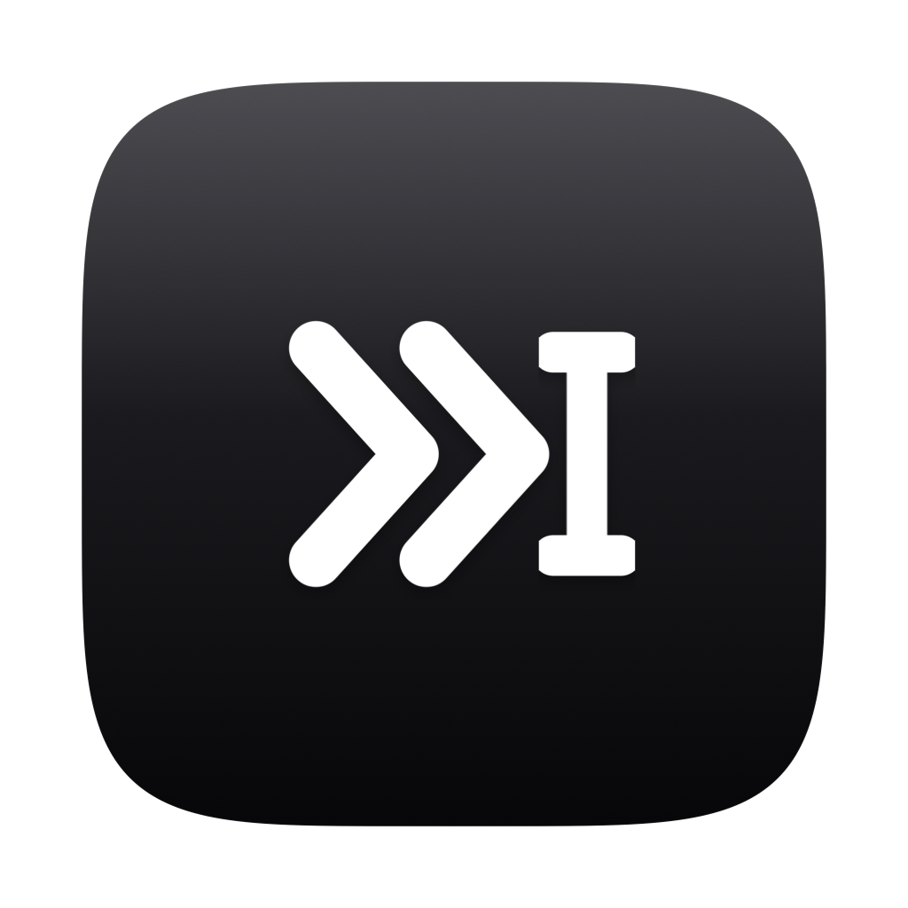
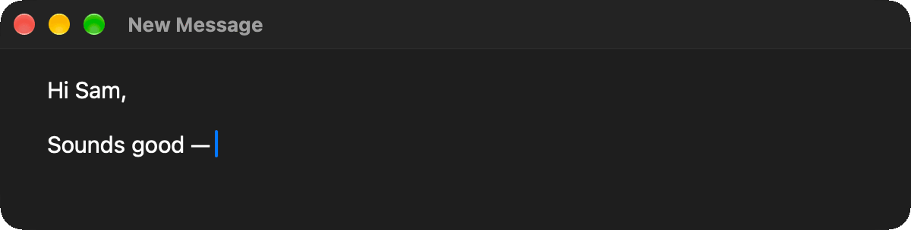
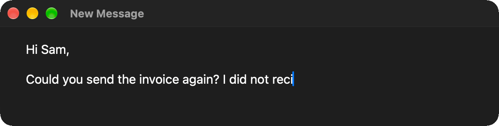
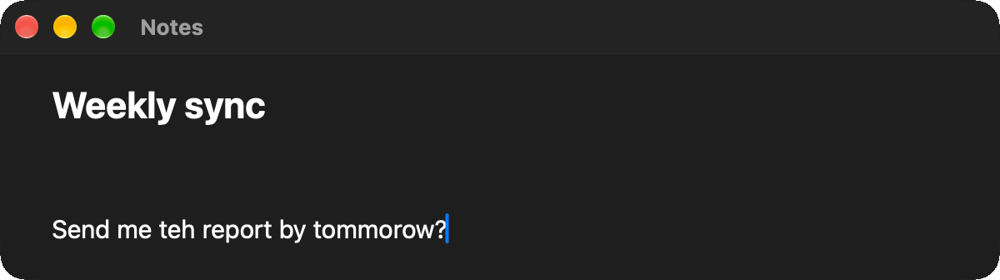
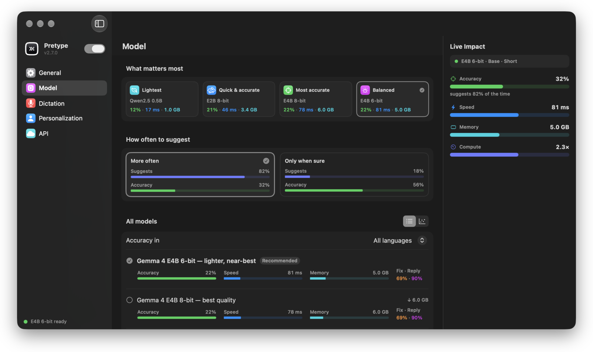
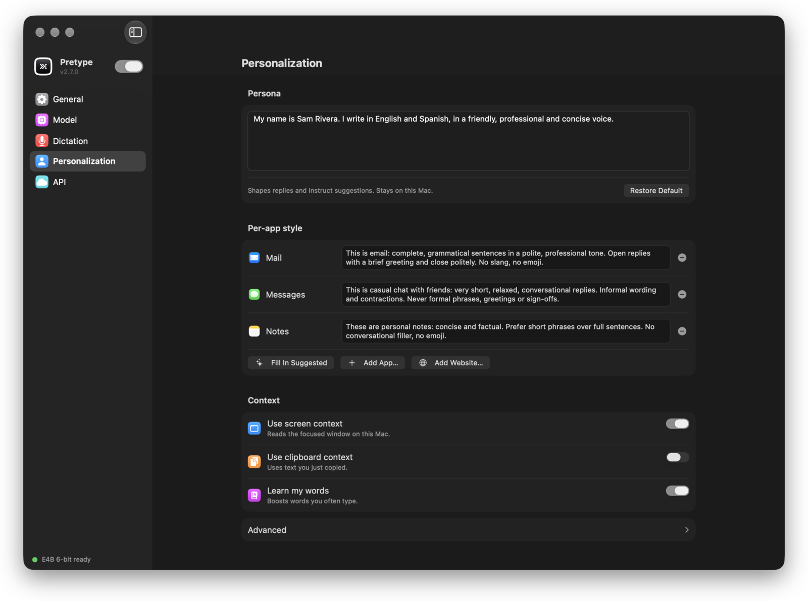
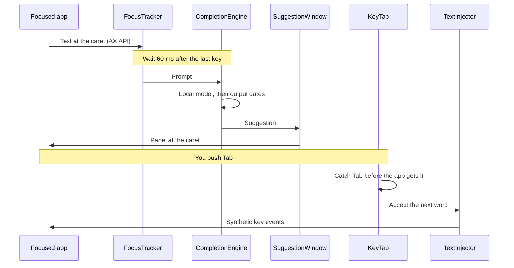

<div align="center">

<picture>
  <source media="(prefers-color-scheme: dark)" srcset="docs/pretype-logo-dark.png" />
  
</picture>

# Pretype

**System-wide AI autocomplete for macOS.**<br/>
Pretype shows a suggestion at the caret in each text field. A local model makes it. Your text stays on your Mac, unless you connect an API provider.

[](https://github.com/nikiomori/Pretype/releases/latest)
[](https://github.com/nikiomori/Pretype/actions/workflows/ci.yml)
[](LICENSE)
[](#quick-start)
[](https://pretype.app)
[](https://huggingface.co/nikimori)

<p>
  <a href="#features"><b>Features</b></a> ·
  <a href="#quick-start"><b>Quick Start</b></a> ·
  <a href="docs/models.md"><b>Models</b></a> ·
  <a href="docs/privacy.md"><b>Privacy</b></a> ·
  <a href="docs/troubleshooting.md#faq"><b>FAQ</b></a>
</p>

<a href="https://github.com/nikiomori/Pretype/releases/latest/download/Pretype.app.zip">
  
</a>

<br/><br/>



<sub>*You type. The local model makes a suggestion. <kbd>Tab</kbd> accepts one word. <kbd>⇧Tab</kbd> accepts all of it.*</sub>

</div>

---

## Why Pretype?

Most autocomplete tools operate in one editor, and they send your text to a server. Pretype operates in all text fields on your Mac, and a local model makes the suggestions. You do not need an account, a subscription, or an API key. Pretype is a free and independent alternative to [Cotypist](https://cotypist.app).

## Features

<div align="center">


<p><sub><i><b>Typo fix.</b> <kbd>Tab</kbd> applies the fix. <kbd>Esc</kbd> removes it.</i></sub></p>


<p><sub><i><b>Rewrite.</b> <kbd>⏎</kbd> accepts it. <kbd>Esc</kbd> keeps your original text.</i></sub></p>


<p><sub><i><b>Settings show their cost.</b> Hover over an option to see its effect on accuracy, speed, and memory.</i></sub></p>


<p><sub><i><b>A style for each app.</b></i></sub></p>

</div>

### Keys

| Key | Action |
|---|---|
| <kbd>Tab</kbd> | Accept the next word. With no suggestion on the screen, <kbd>Tab</kbd> operates as usual. |
| <kbd>⇧Tab</kbd> | Accept all of the suggestion. |
| <kbd>⌥Tab</kbd> | Fix the selected text. With no selection, fix the last word. You see a preview first. |
| <kbd>⌥⇧Tab</kbd> | Write a draft of your next message from the conversation on the screen. In the prompt of an AI agent, from the agent's session. |
| <kbd>⏎</kbd> / <kbd>Esc</kbd> | Accept or reject a rewrite or a typo fix. |
| Hold <kbd>⌥</kbd> | Dictate while you hold the key. |
| <kbd>⌃⌥D</kbd> | Start or stop hands-free dictation. |

To reject a suggestion, continue to type. You can change the accept key to <kbd>⌘Space</kbd>, <kbd>⌥Space</kbd>, or <kbd>⌃Space</kbd> in Settings.

### What Pretype does

| Feature | What it does |
|---|---|
| **All text fields** | Native apps, Electron apps (VS Code, Slack, Claude Desktop), and web pages. In Terminal, iTerm2, and the VS Code terminal, only the prompts that you type to an AI agent, for example Claude Code. There, the file names and the symbols that the agent shows complete at once. |
| **Typo fixes** | A pill shows above a misspelled word. The macOS spell checker finds the error in the language of the text. |
| **Rewrites** (<kbd>⌥Tab</kbd>) | The local model fixes grammar, typos, and phrasing. It keeps your tone. The best model fixes 69% of noisy lines exactly. |
| **Reply drafts** (<kbd>⌥⇧Tab</kbd>) | The local model writes your next message from the conversation on the screen. With the best model, 90% of the replies are on topic. An independent model rates them. In the prompt of an AI agent, the draft answers the agent's session. It reads the terminal text and needs no Screen Recording. With **Offer replies in chats** on, the draft comes when the agent finishes its turn. |
| **Emoji and symbols** | `:shrug:` gives 🤷, `:rocket:` gives 🚀, `:cmd:` gives ⌘. |
| **Arithmetic** | `12*7=` gives 84. |
| **Speed** | A suggestion takes 17–81 ms on the local models. |
| **Your style** | A persona, and a style for each app and each website. Pretype also learns from a local journal. You can clear the journal or disable it. |
| **Shared app styles** | Styles from the community. One click adds the styles for the apps on your Mac. To share your style, add [one text file](AppStyles/README.md). |
| **Hosted models** *(optional, off)* | OpenAI, Anthropic, Google Gemini, Groq, Mistral, OpenRouter, DeepSeek, or a local server such as Ollama or LM Studio. Keys stay in your keychain. See [Hosted models](docs/models.md#hosted-models-api). |
| **One switch for each feature** | Suggestions, fixes, replies and dictation each have a switch in **Settings → General**. Typo fixes, emoji and arithmetic also have their own switches. With suggestions off, Pretype loads a model only for a fix or a reply. |
| **Words** *(optional)* | Pretype completes only the word that you type, from your own words and the macOS dictionary of the language that you type. No model loads. Select **Words** in **Settings → General → Suggestions**. On a Mac with 8 GB, Words is the default. When memory pressure unloads the model, suggestions use Words for two minutes. |
| **18 interface languages** | The interface uses the language of macOS. You can change it in **Settings → General**. |

[Choosing a model](docs/models.md) has the measurements for each model.

### Where Pretype stops

* You can disable Pretype for one app or one website from the menu.
* To keep only the fixes, disable **Suggestions** in **Settings → General**.
* Pretype does not operate in password managers, in the shell, or while macOS reports secure input.
* **Pause on Battery** stops suggestions while the Mac is not connected to power.
* If you almost never accept the suggestions in an app, Pretype stops in that app. The menu shows a **Resume** item.

### Dictation *(off by default)*

* Hold <kbd>⌥</kbd>, say a sentence, and release the key. For longer text, push <kbd>⌃⌥D</kbd> to start and push it again to stop.
* The speech models of macOS transcribe on your Mac. Audio does not go to the disk.
* A tidy-up pass adds the punctuation and the capital letters.
* Dictation uses the language of your keyboard layout.
* **Names.** Names and terms in the field, and in the session of an AI agent, come out as they are written there: "mlx" becomes "MLX", "suggestion controller" becomes "SuggestionController". This also operates with Parakeet. Add your own names and terms in **Settings → Dictation → My words**. Dictation always writes them as you wrote them there.
* **Voice commands.** Select text and dictate an instruction, for example *"make it shorter"* or *"translate to English"*. Enable this in **Settings → Dictation → Advanced**.
* **Send.** Pretype can push <kbd>Return</kbd> after a dictation, for example in a chat. To enable this for an app, select **Press Return after Dictation** in the menu.
* If the focus changes during a capture, Pretype puts the transcript on the clipboard.
* **History.** To get a lost dictation back, select **Copy Recent Dictation** in the menu. The menu keeps the last five transcripts until you quit Pretype.

| Languages | Speech model |
|---|---|
| English, German, Spanish, French, Italian, Japanese, Korean, Portuguese, Chinese | Apple `SpeechTranscriber`. It gives punctuation. |
| All other languages, **Russian included** | Apple `DictationTranscriber`. It is older and gives no punctuation. You can select **Parakeet** (one download of ~610 MB) instead, in **Settings → Dictation** when Pretype shows its interface in that language. On Russian, Parakeet makes less than half the word errors: 5.4% WER against 12.6% on FLEURS. |
| All languages | A hosted speech model, if you select an API provider in **Settings → API**. |

[Architecture → Dictation](docs/ARCHITECTURE.md#dictation) gives the details.

## Privacy

Pretype must have the **Accessibility** permission. It uses it to read the focused text field, to catch the accept key, and to type the suggestion.

By default, your text stays on your Mac. Pretype uses the network only for model downloads and one version check each day. If you turn on an API provider in **Settings → API**, your text goes to that provider.

Do not trust these statements without proof. Three files read the field, watch the keys and type text back: [`AXText.swift`](Sources/Pretype/AXText.swift), [`KeyTap.swift`](Sources/Pretype/KeyTap.swift), and [`TextInjector.swift`](Sources/Pretype/TextInjector.swift). [Privacy & permissions](docs/privacy.md) lists the optional reads (screen, clipboard, microphone), each connection and all data on disk.

## Quick Start

You must have macOS 26 or later and a Mac with Apple Silicon (M1 or newer). 8 GB of memory is sufficient.

```bash
brew install nikiomori/tap/pretype
```

Or download [`Pretype.app.zip`](https://github.com/nikiomori/Pretype/releases/latest/download/Pretype.app.zip), unzip it, and move `Pretype.app` to `/Applications`. Apple notarizes all releases since 2.5.0.

1. Open Pretype. It has no Dock icon. It operates from the menu bar.
2. Grant the **Accessibility** permission. If you grant it after the launch, restart Pretype.
3. Wait for the model download to complete. The menu-bar icon shows the progress.
4. Type in a text field.

The download of the default model is ≈1.5–5.3 GB. Pretype selects the default model from a fixed table of Mac memory sizes. The default uses less than a quarter of the memory. To use a different model, go to **Settings → Model**. [Choosing a model](docs/models.md) compares the models.

To build from source, see [Development setup](CONTRIBUTING.md#development-setup).

## How It Works



[Architecture](docs/ARCHITECTURE.md) gives the details.

## Documentation

You can read the documentation at **[pretype.app/docs](https://pretype.app/docs)**. The source is in [`docs/`](docs/).

| Page | Contents |
|---|---|
| [**Choosing a model**](docs/models.md) | The eval for the defaults, the RAM and latency of each tier, and the hosted-model presets |
| [**Privacy & permissions**](docs/privacy.md) | Each permission, each connection, the data on disk, and how to remove all of it |
| [**Troubleshooting & FAQ**](docs/troubleshooting.md) | How to read Diagnostics, the usual problems, and the frequent questions |
| [**Architecture**](docs/ARCHITECTURE.md) | The engines, the model catalog, the KV cache, and how the app decides to show no suggestion |

## Contributing

We accept bug reports, ideas, and pull requests.

* [Open an issue](https://github.com/nikiomori/Pretype/issues) for bugs and feature requests.
* Read the [Contributing Guide](CONTRIBUTING.md) and the [Code of Conduct](CODE_OF_CONDUCT.md).
* Report security issues privately, as [SECURITY.md](SECURITY.md) tells you.

If Pretype is useful to you, give it a star (⭐). Stars help other people find the project.

## Acknowledgements

| Project | Use in Pretype |
|---|---|
| [MLX](https://github.com/ml-explore/mlx) and [mlx-swift-lm](https://github.com/ml-explore/mlx-swift-lm) | The on-device ML stack from Apple |
| [Gemma](https://ai.google.dev/gemma) | The default model on Macs with 16 GB or more |
| [Qwen](https://huggingface.co/Qwen) | The default model on 8 GB Macs |
| [MiniCPM](https://huggingface.co/openbmb) | One of the two fastest models in the catalog |
| [swift-transformers](https://github.com/huggingface/swift-transformers) | The tokenizers |
| [swift-huggingface](https://github.com/huggingface/swift-huggingface) | The Hugging Face hub client and cache |
| [Cotypist](https://cotypist.app) | The original idea |

## License

MIT. You can use Pretype free of charge for personal and commercial work. The bundled libraries and the downloadable model weights have their own licenses. See [THIRD_PARTY_NOTICES.md](THIRD_PARTY_NOTICES.md).
