# Architecture

This page tells how Pretype operates. It is for persons who read the code.
The [README](../README.md#how-it-works) gives a short summary for users.

## Terms

| Term | Meaning |
|---|---|
| Suggestion | The text that Pretype shows at the caret. |
| Accept key | The key that types the suggestion. <kbd>Tab</kbd> types one word. <kbd>⇧Tab</kbd> types all of it. |
| Engine | The code that runs a model and returns a suggestion (`CompletionEngine`). |
| Base style, Instruct style | The two completion styles. Base style continues the raw text. Instruct style uses a chat template and a persona. |
| Instruct sibling | The instruction-tuned build of the completion model. The fix chord (<kbd>⌥Tab</kbd>) and the reply draft use it. |
| KV cache | The state of the model for the prompt. The engine keeps it from one key press to the next. |

## From a key press to a suggestion

`FocusTracker` follows the focused text element with `AXObserver`. An AX
change notification starts a read of the text at the caret. Some apps, for
example Electron apps, do not send reliable notifications. Thus each key press
also starts a read 60 ms later.

Before a request, `SuggestionController` does these checks, in this sequence:

| Condition | Result |
|---|---|
| Pretype is off in this app or on this site, or macOS reports secure input | No suggestion. |
| Text is selected | Fix mode (<kbd>⌥Tab</kbd>). `CorrectionController` controls the overlay. |
| A typo fix, an emoji shortcode or a sum is at the caret | The correction pill shows. No completion. |
| A letter or a digit is immediately after the caret | No suggestion. A completion here joins the rest of the word. |
| You type the same characters as the suggestion | The suggestion becomes shorter. No new request. |
| You almost never accept suggestions in this app | No suggestion. The menu shows the numbers and a *Resume* item. |
| *Pause on Battery* is on and the Mac is on battery | No completion. Typo fixes and emoji shortcodes continue. |
| Your personal n-gram model has a confident match | That suggestion shows at once. The model output replaces it later. |

`FieldState.admit` decides about each read: use it, read again, or drop the
suggestion. `RereadSchedule` decides if a key press needs its own read 60 ms
later, or if an AX notification already gave one.

The collaborators of `SuggestionController` see it only through narrow
protocols: `CorrectionHost`, `PromptContextHost`, `IndicatorHost`,
`ReplyHost` and `DictationHost`. Tests drive a real `SuggestionController`
with fakes through `SuggestionController.Environment`, and a real
`FocusTracker` through `FocusTracker.AXCalls`. The pipeline writes `Stats` and
the journal only through `Environment.book`, and every synthetic key goes out
through `TextInjector.post`, so tests see both. The clock (`Environment.now`)
and the journal lookup (`Environment.similarAcceptedPhrases`) are injectable
too. In a test process, `Settings` uses a private defaults file for each run
(`Settings.store`), so parallel test runs do not share settings.

When you press the accept key, `KeyTap` holds the key, and the app does not
get it. `TextInjector` then types the text as synthetic key events. The tap
holds the key only while a suggestion is on the screen.

## Inference engines

Three engines implement the `CompletionEngine` protocol
(`Sources/Pretype/Engines/CompletionEngine.swift`):

| Engine | What it runs | Notes |
|---|---|---|
| `MLXEngine` *(default)* | The selected model, in the Pretype process, through Apple's `mlx-swift-lm`. | The weights download from Hugging Face on first launch. The cache is in `~/.cache/huggingface`. |
| `FoundationModelsEngine` *(macOS 26 and later)* | The Apple Intelligence system model, on the Neural Engine, through the `FoundationModels` framework. | No download and no app memory. It gives no logprobs, thus the confidence gate cannot run on it. |
| `CloudEngine` *(optional, off by default)* | A hosted model, or a local server such as Ollama, over HTTP. | The user turns it on in **Settings → API**. Then it replaces the other two engines for suggestions, the fix chord, the reply chord and voice commands. See [API providers](#api-providers). |

To add an engine, use `FoundationModelsEngine.swift` as a compact
reference.

### API providers

`CloudEngine` (`Engines/CloudAPI.swift`) and `CloudTranscription`
(`Dictation/CloudTranscription.swift`) send requests to a provider that the
user selects. Text and dictation have separate settings. Both are off by
default.

| Item | Text (`CloudEngine`) | Dictation (`CloudTranscription`) |
|---|---|---|
| Request | `chat/completions` in the OpenAI format, or `messages` in the Anthropic format. | `audio/transcriptions` in the OpenAI format. |
| Prompt or payload | The continuation prompt of `FoundationModelsEngine` (`CompletionRequest.continuationTurn`). The fix, reply and command prompts of the local engines. | One WAV file (16 kHz, 16-bit, mono) when the capture stops. A hosted model gets no live preview. A server on this Mac gets the take so far about once a second. |
| Output | The shared output gates of the local engines. | The same tidy-up pass as a local transcript. |
| Length | A words hint in the prompt, and a word cap on the result (`CloudEngine.wordCap`). A token budget cannot set the length, because a reasoning model uses tokens before its first word. | One take. OpenAI and Groq accept up to 25 MB, which is ≈13 minutes. |
| Spelling hints | — | The names and terms in the field. `gpt-transcribe` gets them as `keywords[]`. Whisper models get them as `prompt`. |
| Failure | A suggestion abstains and logs the reason. A rejected key (HTTP 401) sets the engine to failed. The fix and reply chords show the error. | Each request stops after 55 s, plus 0.3 s for each audio second. A network error, a timeout, HTTP 429 or a 5xx sends the same take one more time, after 1 s. The watchdog waits 120 s plus 0.6 s for each audio second, not 10 s, because it must include the two uploads. When both fail, or the watchdog fires, an installed on-device model transcribes the take from memory, with a limit of 30 s plus 0.1 s for each audio second. A cancelled take stops its upload and has no fallback. |

* **Two wire formats.** Most providers and local servers use the OpenAI
  format. Anthropic uses its own Messages API, with the `x-api-key` and
  `anthropic-version` headers. Pretype uses no SDK.
* **Reasoning off.** Most current models reason before they answer, by
  default. For autocomplete, this adds seconds. Thus each preset has
  `textExtras`: the switch of that provider that turns reasoning off or
  down.
* **A model that refuses the switches.** The user can type a different
  model. If the server then answers HTTP 400, Pretype sends the request
  again without the switches. It remembers that model until it quits.
* **Keys.** Pretype keeps each key in the login keychain (service
  `app.pretype.api-key`, one item for each provider). Settings and the log
  never contain a key.
* **Cancellation.** A new keystroke cancels the request in flight. The
  client reports this as `CancellationError`, as the local engines do.

[Choosing a model → Hosted models](models.md#hosted-models-api) lists
the presets.

## Model catalog

Pretype selects the default model one time per launch, from the physical
memory of the Mac. The function is `ModelCatalog.defaultID(forRamGB:)`.

The rule selects the best Gemma tier whose resident model stays in about a
quarter of the RAM. The quality sequence is E4B 6-bit, then E2B 8-bit, then
E2B 4-bit. The resident model is the model in its recommended configuration
(the base build: all Gemma tiers run Base style). Qwen3.5 2B M40 is the floor below the smallest Gemma tier
([why](models.md)). On that tier, `Settings.suggestionMode` starts as Words:
the model loads only for a fix, a reply or a dictation clean-up.

The thresholds are a fixed table. We sized them on the builds before the slim
re-packs, thus the quarter rule has a margin. The default is not stored: the
app calculates it at each launch. Thus, a change to a threshold moves each
install of that memory size to a different model. That is a download of
several GB that nobody asked for.

Keyboard layouts do not select the model. They select the persona and the
per-language nudge in the menu. You select all other models manually in
**Settings → Model**:

| Model | Memory | Why you select it |
|---|---|---|
| Gemma 4 E4B 8-bit | ≈6.0 GB | Best measured quality. It holds up across all 19 eval languages. It is never the default, because it ties 6-bit. |
| **Gemma 4 E4B 6-bit** | ≈5.0 GB | *Default from 32 GB.* It ties E4B 8-bit (p=0.28) and the download is smaller. Its fix sibling is the best in the catalog. |
| **Gemma 4 E2B 8-bit** | ≈3.4 GB | *Default at 24 GB.* Statistically level with E4B on completions, with less memory and ~40% less time per suggestion. |
| **Gemma 4 E2B 4-bit** | ≈2.5 GB (≈1.2 GB on 16 GB, see [Reduce memory use](models.md#reduce-memory-use-gemma)) | *Default at 16–18 GB.* The smallest 4-bit cost in the field. |
| MiniCPM5 1B | ≈1.1 GB | One of the two fastest models in the catalog, at 18 ms. Strong on English, weaker in other languages. |
| Ternary Bonsai 4B | ≈1.1 GB | A 4B model in about one gigabyte. |
| **Qwen3.5 2B (Base)** | ≈1.5 GB | *Default on 8 GB.* The best model below 2 GB for many languages (p<0.001). |
| Qwen3.5 2B M40 | ≈1.5 GB | A mix of the Base and post-trained builds. One model completes text and runs the chords. It ties the Base build on completion, and its fix is better than the post-trained sibling (p<0.001). |
| Qwen2.5 0.5B | ≈1.0 GB | The smallest footprint in the catalog. |

The sizes are the measured model memory (`ModelMetrics.ramGB`). A download
can be a little larger, for example 5.3 GB for E4B 6-bit.
The Gemma tiers download slim re-packs (`ModelCatalog.slimRepos`). Qwen3.5
completes text on its Base build, and MiniCPM5 on an 8-bit build. Both are our
own conversions. On both models, the fix chord (⌥⇥) and the reply draft run on
the post-trained Qwen3.5 build.

### Quantization

Quantization is not a free axis, and its cost is not the same for all
families:

* **E4B below 6-bit collapses.** We removed E4B 4-bit from the catalog. Its
  measurement was a statistical tie with the floor of the field.
* **E2B at 4-bit has the smallest 4-bit cost that we measured.** It is level
  with 8-bit on English (28 vs 26) and on Russian (22 vs 25). Across 17
  languages it is about two points behind 8-bit (p<0.001).

To make the footprint smaller, use a smaller model, not fewer bits.

### Figures per language

We give the figures for each language separately. A pooled "EN/RU" number
hides the most important split for the small models. MiniCPM5 ties Gemma E2B
8-bit on English (28 vs 26, p=0.12). On Russian it is 8 points lower (17 vs
25, p<0.001).

Each language cell has 280 rows (English 560, Russian 689). That gives
±5 pp near 20%. The app shows this tolerance next to each figure. Thus a
two-point gap shows as the tie that it usually is.

On the Gemma builds, the **Instruct** completion style loads an instruct
sibling of the same RAM class. Thus no selection loads weights that are too
large for the Mac.

The measured figures are in `Sources/Pretype/Engines/ModelMetrics.swift`.
The eval sets, the sample sizes and the significance tests are next to them.
The eval harness and the datasets are not in the public repo. Refer to
*Quality eval* in [CONTRIBUTING](../CONTRIBUTING.md#quality-eval--please-measure-promptmodel-changes).

## Latency

| Mechanism | What it does | Effect |
|---|---|---|
| KV-cache reuse | Each key press prefills only the new tokens. The engine reuses the cache of the prompt. Some caches cannot rewind: the recurrent layers of Qwen3.5, and a Gemma sliding window that is shorter than the prompt. For these, the engine reuses a checkpoint from a few tokens before the end of the prompt. | Warm suggestions in 17–81 ms (`ModelMetrics.p50Ms`). Apple Intelligence is the outlier at 480 ms. |
| Stable context window | Past the context window, the prompt starts at a sentence boundary. Its first tokens do not change while you type. | The cache stays valid. |
| Early stop | Decoding stops at the cut of the confidence trim. A gated suggestion stops when its first word fails the gate. It streams after its first word passes. | No decode time for text that nobody sees. |
| Background warm-up | The screen, clipboard and retrieved-example blocks are at the start of the prompt. A change to one of them makes the cache invalid. The engine prefills the new prompt when the change arrives, not at the next key press. | The next key press does not wait for a full prefill. |
| Lighter 6-bit and 8-bit Gemma | The Gemma downloads ship the tied embedding table at 4-bit. This table is also the output projection (262k rows), which each token reads. | 160–320 MB less memory. Same suggestion accuracy on the eval set. |
| Speculative fixes and replies | A Gemma instruct model runs ⌥⇥ and the reply draft with the multi-token-prediction drafter from Google (~150 MB). This model is the instruct primary, or the fix model of base style. The drafter downloads in the background on first use. Streamed completions do not use it, because before the first word the speculative start costs more than it saves. | 20–40% faster. Same output quality. |
| Debounce and cancel | A request starts 60 ms after the last key press. Fast typing replaces the work in progress. It does not put the requests in a queue. | No work on old text. |
| Fast reloads | A downloaded model loads directly from its local snapshot. There is no request to Hugging Face to list the repo. A parsed tokenizer stays in memory after the idle unload. | The next key press waits only for the weights. |
| Idle unload | After `Settings.idleUnloadMinutes`, the engine releases the weights and the RAM. The default is 5 minutes, or 15 minutes on Macs with 32 GB or more. The next key press loads the weights again. Memory pressure from macOS unloads them earlier. While the pressure level (`kern.memorystatus_vm_pressure_level`) is raised, and for 2 minutes after, `Settings.activeSuggestionMode` is Words and nothing loads the completion model (`MemoryPressure`). | The RAM goes back to other apps. A reload does not raise the pressure that unloaded the model. |

## Knowing when to stay quiet

On real held-out text, an autocomplete without a gate is *net-negative*. The
cost to read wrong suggestions is more than the keystrokes that it saves.
Thus Pretype has an **opt-in confidence gate** and an always-on confidence
trim. This diagram shows the checks in base style:

* **Confidence gate.** It is in **Settings → Model → How often to suggest**. It is off by
  default and operates only in base style. The mean log-probability of the
  first word must be at or above a threshold τ. We calibrate τ for each
  model on one half of the eval set and verify it on the other half. The
  calibration uses the log-probability that the app records while it
  decodes, because the gate compares against that value. About 25% of the
  suggestions pass.
* **A stricter τ for some scripts.** For each model, one τ does not fit all
  writing systems. Some models get a stricter τ for Chinese, Korean, Arabic
  or Hebrew. The script comes from the last 64 characters before the caret.
  Latin and Cyrillic text keeps the τ of the model.
* **No suggestions in Japanese.** No on-device model gives Japanese
  suggestions that save more time than they cost. Thus the local models and
  Apple Intelligence do not suggest in Japanese, also when the gate is off.
  The typo fix, the reply and dictation still operate.
* **Chinese and Korean are always gated.** The threshold of the model (or
  its stricter script τ) applies also when the gate is off
  (`ModelCatalog.alwaysOnGateTau`). Apple Intelligence does not suggest in
  these languages.
* **Token healing bypasses the gate.** Healing repairs mid-word completions.
  The match with the typed fragment is already a sufficient filter.
* **Confidence trim.** It operates by default. It cuts the low-confidence tail
  off a suggestion and does not drop all of it. The cut is at the first token
  after the first word with a log-prob below −1.5, or an entropy above
  2.5 nats.
* **Output gates.** They reject, for example, a change of language, an echo
  of the typed text, a duplicate of the text after the caret, and control
  characters.

The thresholds for each model are `Recommendation.logprobGateTau` and
`Recommendation.scriptGateTau` in `ModelCatalog.recommended(for:)`. The output gates are in
`Engines/CompletionGates.swift`.

## Typo corrections and rewrites

| Feature | How it operates |
|---|---|
| Inline typo fix | The macOS system spell-checker. The language is the one that `NLLanguageRecognizer` finds in the text before the caret. |
| Fix selection (<kbd>⌥Tab</kbd>) | The local model rewrites the selection in place. A correction must follow instructions. Thus, on most models in base style, the first <kbd>⌥Tab</kbd> downloads an instruct sibling of the completion model one time. The menu bar shows *preparing…* during the download. Bonsai corrects with itself. In Instruct style, Gemma E4B fixes with the model that is already loaded. |
| Fix the last word (<kbd>⌥Tab</kbd>, no selection) | The model gets the sentence that the word ends, not the word alone. Only the word is replaced (`CorrectionGates.fixLastWord`). With the sentence, the models fix about two times more typos and change fewer correct words. |

## Dictation

Dictation is hold-to-talk. It is off by default.
The code is in `Sources/Pretype/Dictation/`.

### The capture lifecycle

The states are `DictationController.Phase`. Two triggers start a capture, and
they stop in different ways:

| Event | Hold (modifier) | Hands-free (<kbd>⌃⌥D</kbd>) |
|---|---|---|
| Start | Hold the modifier for 0.45 s. | Press the chord. |
| Release before the microphone is open | Back to Idle with a hint. | Not applicable. |
| Stop and type | Release the key. | Press the chord again, or stop to speak. The silence budget is in Settings. Before the first word, the budget is 30 s. |
| Time limit | 120 s, then the capture stops and types. | 600 s, then the capture stops and types. |
| <kbd>Esc</kbd> | Drops the capture. | Drops the capture. |
| Other key, click or scroll | Drops the capture. | No effect. |
| Focus moves to a different field | Drops the capture. | The capture stops. The words that it heard go to the clipboard. |
| Key press or click while Working | The transcript goes to the clipboard, with a notice. A voice command is dropped, with a notice. | Same as for a hold. |
| The final pass fails or times out | The preview goes to the clipboard, with a notice. | Same as for a hold. |
| New hold while Working | Waits. It starts after the insert of the previous transcript. | Waits. A second press removes it from the queue. |

* **The gesture.** `ModifierHold` in `KeyTap.swift` is the complement of
  `ModifierDoubleTap`, the gesture of the reply chord. A hold is never a tap,
  and two taps are never a hold. Thus both gestures can use the same
  modifier.
* **Why a modifier.** The event tap sees only key-down events. Thus a hold
  gesture is possible only on a modifier key.
* **Unit tests.** `ModifierHold` is pure and gets the time as an input. Each
  rule about what does *not* open the microphone is a unit test.
* **The state machine.** `DictationController` talks to the app through the
  `DictationHost` protocol. Its session and audio capture are injectable, and
  it asks the host whether Pretype's own window or secure input is active. Thus unit tests cover the full lifecycle (queued holds,
  focus changes, device loss, watchdogs) without a microphone.

### Which microphone

`AudioDevices` makes this selection. A Bluetooth headset carries good
playback or a two-way call, but not the two at the same time. When an app
opens the AirPods microphone, playback drops to hands-free quality during
the hold. The *Automatic* setting prevents this. It records from the built-in
microphone, and the headset stays in music mode.

macOS shows one headset as two audio objects. Their UIDs are different only
in a `:input` or `:output` suffix at the end. Pretype compares the UIDs
without this suffix.

### Audio capture

* **One device, no output.** `AudioCapture` uses `AVCaptureSession`, not
  `AVAudioEngine`. An `AVAudioEngine` instance builds an aggregate device
  around the system-default input *and output*. That alone puts a Bluetooth
  headset into hands-free attenuation: the music became quieter and then
  louder around each hold. A capture session opens only the microphone.
* **Open only during the capture.** The app makes a new session for each
  capture and **releases** it at the stop. Thus nothing keeps the device
  claimed, and the orange microphone indicator goes off between holds.
* **No storage.** `AudioCapture` resamples each buffer to the format that the
  analyzer asks for. Nothing goes into a buffer, and nothing goes to disk.
* **Device loss.** The capture keeps the device that it opened. A new default
  input does not move it. If that device disappears, the capture opens the
  current selection again and continues. This is possible only when the
  session pinned a format to resample into. Without a pinned format, the
  capture stops, because the analyzer rejects a format change.
* **Limits on restarts.** More than three restarts in three seconds stop the
  capture. With no input left, the capture types the words that it heard. It
  does not discard them.

### Which speech model

* **SpeechTranscriber.** The newer and better model. It covers exactly 30
  locales (en, de, es, fr, it, ja, ko, pt, yue, zh).
* **DictationTranscriber.** The model of the macOS dictation key. It is older
  and serves all other languages, **Russian included**. In our measurement
  on synthesized speech, Russian came back correct but with no punctuation.
  The tidy-up pass restores most of it.
* **Parakeet (opt-in).** The model from NVIDIA, through FluidAudio
  (`Parakeet.swift`). It downloads one time into
  `~/Library/Application Support/FluidAudio`. It serves the languages for
  which Apple has only the older model.
* **API provider (opt-in).** A hosted speech model, for all languages
  (`CloudTranscription.swift`). It overrides the three models above. See
  [API providers](#api-providers).
* **The support rule.** Pretype checks *membership* in `supportedLocales`.
  It does not use `supportedLocale(equivalentTo:)`. That function changes an
  identifier ("ru" → "ru_RU") also when no model exists. The result looks
  like support and then fails at load.
* **One protocol.** `Transcription` wraps Apple's `SpeechAnalyzer` behind the
  `TranscriptionSession` protocol. Parakeet and the API provider use the same
  protocol through one `RecordedTranscription`: it keeps the take in memory
  and transcribes it whole. Thus the controller has no version checks.
* **Zero bytes from us.** The Apple models belong to the system. macOS
  downloads them for each language on first use, and all apps share them.
* **Live pill.** Volatile results update the pill at the caret while you
  speak.

### Tidy-up and insertion

* **Spelling.** `Transcription.spell` writes the bias words as the page
  writes them: a word in a different case ("mlx") or in two or three parts
  ("suggestion controller") becomes the term ("MLX", "SuggestionController").
  It operates after every speech model, because Parakeet takes no contextual
  strings. A term from the page must have an inner capital or a digit. Thus
  a capitalized "Settings" on the screen does not change a spoken "settings".
  The bias words come from the text before the caret and, in the box of an
  AI agent, from the agent's session (`AXText.agentTranscript`).
* **Tidy-up.** The transcript goes through `engine.correct`, the same
  minimal-edit pass as <kbd>⌥Tab</kbd>. Its divergence guard rejects a model
  that starts to paraphrase. Then the text goes in as Pretype heard it.
* **Time budget.** An engine after an idle unload must first load the model
  again. Thus the tidy-up has a 3 s budget. After the budget, Pretype types
  the raw transcript. A transcript of more than 500 characters skips the
  tidy-up.
* **Insertion.** `SuggestionController.insertDictated` uses the same
  bookkeeping as the accept path: cache advance, settle window and
  <kbd>⌘Z</kbd> undo. The hazards are the same.
* **One capture at a time.** A new hold can pass its threshold while the
  previous transcript is in insertion. It waits for that insert and does not
  cancel it.
* **Accounting.** Dictated characters have their own counter. They are not in
  the time-saved figure of the menu. One spoken sentence is equal to a week
  of accepted words, and it changes what that number means.

## Context

| Feature | How it operates |
|---|---|
| App awareness | The prompt style changes with the active app: short completions in chat apps. Pretype is off in password managers. In terminals, it is off except in the prompt box of an AI agent. `AgentPrompt` finds that box in the AX text of the terminal. `AXText.xtermContext` builds that text again for xterm.js terminals. All reads stop while macOS reports secure input. |
| Agent session | In the box of an AI agent, the screen above the box is the agent's session (`AgentPrompt.transcript`). Pretype reads it from AX only on demand, because an xterm.js read is two AX calls for each row. The reply chord answers the session: no OCR and no Screen Recording. The names in the session (identifiers and paths) complete at once while you type them (`AgentPrompt.completion`, journal engine `names`). Pretype reads the names again at the first word of each message. |
| Screen context | Optional and off by default. Apple's Vision OCR reads the focused window to get nearby text, for example the email thread of your reply. It needs Screen Recording. OCR text never goes into the debug log. An exported log has a placeholder with the size only. |

## Where things live

All app code is in `Sources/Pretype/`:

| Area | Files | Job |
|---|---|---|
| Startup and menu | `main.swift`, `AppDelegate`, `StatusMenuController`, `MenuHeaderView`, `BrandMark`, `OnboardingWindow`, `Permissions`, `UpdateChecker` | Entry point and `--ax-probe`. Menu bar, menu-bar icon and Diagnostics. Onboarding, permissions, and the daily release check. |
| Read the field | `FocusTracker`, `AXText`, `RereadSchedule`, `AgentPrompt`, `ScreenContext`, `AppPolicy` | Follow the focused element with `AXObserver`. Read text, caret and font. Read again 60 ms after a key press when no AX notification gave a read. Find an agent prompt in a terminal. Opt-in OCR. Rules for each app and site. |
| Input and output | `KeyTap`, `TextInjector`, `SuggestionWindow` (+`Content`, +`Appearance`, +`Layout`), `CaretIndicator`, `BackgroundProbe` | Event tap, accept keys and modifier gestures. Synthetic key events. The panel, inline ghost text and pills. Light or dark below the overlay. |
| Pipeline | `SuggestionController` (+`Keys`, +`KeyHandling`, +`Focus`, +`Text`, +`Dictation`, +`Environment`), `FieldState`, `RequestGate`, `QuerySlot`, `OfferRecord`, `PromptContext`, `ReplyComposer`, `EngineCoordinator`, `CorrectionController`, `SpellChecker`, `EmojiShortcodes`, `InlineCalculator` | `SuggestionController` is the hub: text → engine → overlay → accept → inject, and dictation inserts. It orders the steps. The rules are in pure types: `FieldState` keeps the ghost, the text cache, the settle time after an injection, the declined suggestion and the ⌘Z record. `RequestGate` decides when a pass over the field asks for a suggestion, and which part of the answer lands. `QuerySlot` keeps the request that is in flight. `OfferRecord` keeps the journal record of the suggestion on the screen. `keyAction` (+`Keys`) is one table that decides each key press: accept, decline, undo, reply, fix or pass the key to the app. `PromptContext` collects OCR, clipboard and personal examples. `ReplyComposer` writes replies through the `ReplyHost` protocol. `EngineCoordinator` controls the life of the engine. `CorrectionController` runs ⌥⇥, last-word fixes and inline spell fixes. |
| Engines (`Engines/`) | `CompletionEngine`, `MLXEngine`, `MLXEngine+Generation`, `MLXEngine+Loading`, `ModelResidency`, `HostPLE`, `FoundationModelsEngine`, `CloudAPI`, `CompletionGates`, `CorrectionGates`, `ModelCatalog`, `ModelMetrics`, `ModelStorage`, `ConfigProjection` | The protocol. Requests, KV cache and decode loop. Model building and the reload-leak blueprints. Which models are resident: one slot for the primary and one for the fix sibling, loads, idle and memory-pressure unloads, and which slot serves fixes. `MLXEngine.routes` sets the load order: a blueprint, then a Gemma build with its per-layer table served from disk (`HostPLE`), then the library factory. The Apple Intelligence engine. API presets, keys, the HTTP client and `CloudEngine`. Shared output gates. Catalog entries, RAM ladder and recommended settings. Measured figures. Disk, deletes and the slim upgrade. |
| Personalization | `SuggestionJournal`, `PersonalNgram`, `TypedLanguage`, `Stats` | The local journal, the personal n-gram model, the typed language and the usage statistics. |
| Dictation (`Dictation/`) | `DictationController` (+`Capture`, +`Finish`, +`Display`), `DictationHost`, `AudioCapture`, `AudioDevices`, `VoiceMeter`, `Transcription`, `Parakeet`, `CloudTranscription` | The state machine and its host protocol. Microphone capture, device selection and the voice level. Apple's `SpeechAnalyzer`. The opt-in Parakeet engine. The opt-in API transcription. |
| Settings UI | `Settings`, `SettingsWindowController`, `SettingsStore`, `SettingsView`, `SettingsSuggestionViews`, `SettingsDictationTab`, `SettingsPersonalTab`, `SettingsUI`, `ModelTabView`, `ModelMapView`, `ImpactRailView`, `APITabView` | Stored defaults. The observable bridge to the pipeline, and its alerts. Tabs. Presets and sharing. The model list and the model map. The Live Impact meters. The API tab. |
| Debugging | `DebugLog` | Ring buffer and Debug Console. |
