# Releasing

The repository has no signing secrets. Thus CI cannot make the build that users download. The maintainer builds, signs and notarizes the release on a Mac. Then the maintainer attaches the zip to a draft release, verifies it, and publishes it.

<div align="center">

</div>

## Procedure

1. **Push the tag.** Tag a commit on `main` that passed CI.

   ```sh
   git tag vX.Y.Z && git push origin vX.Y.Z
   ```

2. **Build locally from the tag.** You need the "Developer ID Application" certificate in the keychain. You also need the notary profile. Create the profile one time with `xcrun notarytool store-credentials pretype`.

   1. Check out the tag. The working tree must be clean: `git status --short` must show nothing.
   2. Run `dist.sh` with `PRETYPE_VERSION`. It builds the app with `make-app.sh`, then signs, notarizes and staples it.
   3. Go back to `main`.

   ```sh
   git switch --detach vX.Y.Z
   git status --short                         # must show nothing
   PRETYPE_VERSION=X.Y.Z ./Scripts/dist.sh    # make-app.sh, hardened-runtime sign, notarize (--keychain-profile pretype), staple
   git switch main
   ```

   The scripts stop before the build in these conditions:
   * `PRETYPE_VERSION` is not set. `dist.sh` signs only an app that it builds from the tag. It never signs an existing `build/Pretype.app`.
   * The working tree has a change or an untracked file.
   * `HEAD` is not at the tag `vX.Y.Z`.
   * The "Developer ID Application" certificate is not in the keychain.

   > **NOTE:** `notarytool --wait` can stop after a short network failure. The submission continues on the server. Do not submit again. Do the steps in [If notarytool stops](#if-notarytool-stops).

3. **Create a draft release with the zip.** GitHub generates the release notes.

   ```sh
   gh release create vX.Y.Z build/Pretype.app.zip --draft --generate-notes
   ```

4. **Verify the zip that is attached to the release**, not the local copy.

   ```sh
   rm -rf /tmp/pt && gh release download vX.Y.Z -p Pretype.app.zip -D /tmp/pt
   ditto -x -k /tmp/pt/Pretype.app.zip /tmp/pt
   spctl -a -t exec -vv /tmp/pt/Pretype.app      # expect: source=Notarized Developer ID
   xcrun stapler validate /tmp/pt/Pretype.app    # expect: The validate action worked!
   ```

5. **Publish the draft.**

   ```sh
   gh release edit vX.Y.Z --draft=false
   ```

6. **Bump the Homebrew cask** in `nikiomori/homebrew-tap` (`Casks/pretype.rb`):
   1. Set `version` to `X.Y.Z`.
   2. Set `sha256` to the output of `shasum -a 256 build/Pretype.app.zip`.
   3. Commit with the message `pretype X.Y.Z`.

## If notarytool stops

`dist.sh` stops when `notarytool --wait` stops. The signed app is in `build/dist/Pretype.app`, but it has no ticket yet. Do not run `dist.sh` again. Do these steps:

1. Find the ID of the submission. Use the entry with the newest `createdDate`.

   ```sh
   xcrun notarytool history --keychain-profile pretype
   ```

2. Wait for the result. The status must be `Accepted`. If the status is `Invalid`, read the reason with `xcrun notarytool log <id> --keychain-profile pretype`.

   ```sh
   xcrun notarytool wait <id> --keychain-profile pretype
   ```

3. Staple the ticket to the app. Then make the zip again from the stapled app.

   ```sh
   xcrun stapler staple build/dist/Pretype.app
   rm -f build/Pretype.app.zip
   ditto -c -k --keepParent build/dist/Pretype.app build/Pretype.app.zip
   ```

4. Validate the app.

   ```sh
   xcrun stapler validate build/dist/Pretype.app   # expect: The validate action worked!
   spctl -a -t exec -vv build/dist/Pretype.app     # expect: source=Notarized Developer ID
   ```

5. Continue with step 3 of the [procedure](#procedure).
