# Choosing a model

We measure every model in the catalog on the same held-out eval. The Apple Intelligence system model is in the eval too. The eval measures first-word accuracy on real human text. If a model stays silent, the eval counts a miss. We ran the full eval again on 2026-10-15, on the engine as it ships.

## Which model to use

For most people, the correct answer is the default. Pretype selects the default from the memory of your Mac. Change it only for the cases in the diagram and the table below.

| Situation | Model | Evidence |
|---|---|---|
| You type in English | Any downloadable model. For speed, MiniCPM5 1B. | No downloadable model is measurably better than another. All eight score between 26% and 29%. That is inside the ±5 pp of a single-language cell. MiniCPM5 1B and Qwen2.5 0.5B are the fastest models in the catalog: 17–18 ms. |
| You type in English and have little free memory | Qwen2.5 0.5B | It runs in ≈1 GB. On English, its accuracy is equal to the other models. |
| You type in another language | The default | Outside English, the tie stops. The Gemma 4 tiers lose 4–9 points. MiniCPM5, Bonsai and Qwen 0.5B lose more than half of their English score. |
| You type in another language on an 8 GB Mac | Qwen3.5 2B (Base), the default | Of the small models, Qwen3.5 2B loses the least. It is the best model below 2 GB. It is better than Bonsai, Qwen 0.5B and the larger MiniCPM5 (all p<0.001). |
| You type in Russian | The default. A Gemma tier from 16 GB. | See [English and Russian are different](#english-and-russian-are-different). |
| You type in Arabic or Hebrew | The default. Do not use MiniCPM5 for Hebrew. | See [Arabic and Hebrew](#arabic-and-hebrew). |
| You want no download and no app memory | Apple Intelligence (macOS 26+) | It is last on accuracy and on speed: 480 ms, against 17–81 ms. On macOS 27 it shows a suggestion for almost every prompt, also in Polish, Romanian and Czech. But it is correct less often than any downloadable model. |
| You want the best quality and have the memory | Gemma 4 E4B 8-bit | It ties E4B 6-bit (p=0.28), and it uses ≈1 GB more. You must select it manually. |

### English and Russian are different

We do not average English and Russian into one figure. Every small model is stronger in English than in Russian.

* MiniCPM5 ties Gemma E2B 8-bit on English: 28% against 26% (p=0.12).
* On Russian, MiniCPM5 loses 8 points: 17% against 25% (p<0.001).
* In the small class, Qwen3.5 2B is the strongest on Russian: 21% against 17% for MiniCPM5. This gap is a trend only (p=0.018).
* The lightest Gemma tier, E2B 4-bit, is better than MiniCPM5 on Russian (direct McNemar p=0.001). It ties Qwen3.5 2B there (p=0.19).

Thus the memory ladder gives Russian typists a Gemma tier when the Mac has sufficient memory. On English, the tiers tie. There, the larger model gives better fix and reply chords, not better completions.

### Arabic and Hebrew

We measure these two languages on a separate set: 560 held-out rows (first run 2026-07-25, again 2026-10-15). They are the most difficult languages in the catalog.

| Model | Result |
|---|---|
| Every small model | 3–13%. |
| Gemma E2B 8-bit | 10% Arabic, 18% Hebrew. This is approximately two times the small models. Use a Gemma tier if your Mac has the memory. |
| MiniCPM5 | 3% on Hebrew. Do not use it for Hebrew. |
| Apple Intelligence | It shows a suggestion more frequently than any downloadable model (84–87% of the time). But only 6% of the suggestions are correct. |

Inline typo fixes do not work in these two languages. macOS lists them as spell-check languages, but it has no dictionary for them.

### Qwen3.5 2B uses its Base build

Since 2026-10-11, Qwen3.5 2B completes text with its Base build. This build is our own MLX conversion: [nikimori/Qwen3.5-2B-Base-6bit](https://huggingface.co/nikimori/Qwen3.5-2B-Base-6bit).

* Accuracy: 17.1% of all rows, against 16.1% for the post-trained build (p=0.005).
* Since 2026-10-14, the build is 6-bit. It gets 19% of all rows, against 17% for the 4-bit build (p<0.001). An 8-bit build is not better (19%, 1.9 GB).
* Size: 1.5 GB.

### MiniCPM5 1B uses an 8-bit build

Since 2026-10-15, MiniCPM5 1B completes text with an 8-bit build. Before, it used the bf16 weights from the hub. This build is our own MLX conversion: [nikimori/MiniCPM5-1B-Base-8bit](https://huggingface.co/nikimori/MiniCPM5-1B-Base-8bit).

* Accuracy: the 8-bit and bf16 builds tie. Each gets 15% of all rows (14 against 21 discordant rows). English: 28% for both.
* Size: 1.1 GB, against 2.0 GB.
* Speed: about 30% faster per suggestion.
* A 6-bit build is a little worse, and a 4-bit build is worse (12%, p<0.001).

The fix and reply chords of MiniCPM5 now run on the post-trained Qwen3.5 2B build. MiniCPM5's own instruct build fixed 4% of rows and wrote 35% usable replies. The Qwen3.5 build fixes 33% and writes 72%. It is also smaller: 1.6 GB, against 2.2 GB.

If your install has the bf16 build, Pretype downloads the 8-bit build in the background. When the 8-bit build has loaded, Pretype deletes the bf16 build.

### The Gemma tiers use Base style

Since 2026-10-14, the recommended style of Gemma E2B 4-bit and E2B 8-bit is Base. Since 2026-10-15, the recommended style of Gemma E4B 6-bit and E4B 8-bit is also Base. Before, it was Instruct.

E2B:

* On real text, E2B 4-bit in Instruct style with the default persona gets the first word on 5% of all rows. In Base style, it gets 21% (paired: 988 against 87 discordant rows).
* English: 14% against 28%. Russian: 9% against 23%.
* Base style is also faster: p50 48 ms against 64 ms.
* The fix and reply chords run on the instruct sibling. It loads on the first chord.
* If you use the recommended settings, Pretype downloads the Base build in the background. When the download is complete, Pretype changes the style.

E4B:

* On real text in 17 languages, E4B-it 6-bit in Instruct style with the default persona gets the first word on 15% of all rows. E4B 6-bit in Base style gets 23% (p=5e-53).
* English: 21% against 29%. Russian: 16% against 24%.
* Instruct style offers a suggestion on 99% of prompts, and Base style on 82%. But the Instruct suggestions are wrong more often.
* The fix and reply chords run on E4B-it 6-bit, the same build that Instruct style used. Thus an install that used Instruct style downloads no new sibling.
* The update works as for E2B: Pretype downloads the Base build in the background, and then changes the style.

Instruct style stays available on E4B as a manual choice. It is the only tier where Instruct style continues the text and fills in text in the middle of a line.

## The default follows the memory of your Mac

Since 2026-07-25, Pretype selects the default from the memory of your Mac. Before that date, your keyboard layouts selected it. The default is the strongest tier whose resident model uses about a quarter of physical memory or less.

| Mac memory | Default | Resident (recommended config) |
|---|---|--:|
| 8 GB | Qwen3.5 2B (Base) | ≈1.5 GB |
| 16–18 GB | Gemma E2B 4-bit | ≈2.5 GB |
| 24 GB | Gemma E2B 8-bit | ≈3.4 GB |
| 32 GB and up | Gemma E4B 6-bit | ≈5 GB |

The rule does not use language, for two reasons:

1. No per-language gap between the small models is statistically significant. On English, MiniCPM5 and Qwen3.5 tie (p=0.65). On Russian, the Qwen3.5 lead is a trend only (p=0.018). Japanese is p=0.19.
2. The chord measurements were strongly against the old English/Russian default. MiniCPM5's own fix worked on only 4% of rows. Since 2026-10-15, MiniCPM5 runs the chords on the Qwen3.5 sibling.

Two models stay as manual selections:

* MiniCPM5 1B, for the lowest latency (18 ms). Qwen2.5 0.5B is as fast (17 ms), but less accurate outside English.
* Gemma 4 E4B 8-bit, for the best quality. It ties 6-bit (p=0.28) and uses ≈1 GB more.

### When the default changes

An update can change the default for your Mac. A move to a Mac with more memory can also change it. If Pretype selected your model, it moves you to the new default:

1. Your current model continues to serve.
2. Pretype downloads the new default in the background, on an unmetered network only. The menu bar status shows the progress.
3. When the download is complete, Pretype changes to the new default and its recommended settings.

The old model stays on disk. To delete it, go to **Settings → Model**. If you selected a different model yourself, Pretype keeps it.

Your keyboard languages continue to set the persona and the per-language menu suggestion. To change the model, use **Settings → Model**. Each entry has its own recommended settings from the eval. The catalog ranks the models again for each of the 19 evaluated languages.

<i>The app shows the same data: a speed × accuracy map, presets you can apply with one click, and an accuracy axis for each language.</i>

**Chart method.**
The chart uses an equal-weight mean over `cs de es fr it ja ko nl pl pt ro ru sv tr uk zh`. It uses only matched register cells.
We measured Arabic and Hebrew later, on their own set. They are not in the chart.
Do not compare absolute values *between* languages: zh and ja are character-masked. Thus the mean shows the spread across languages, not the skill in one language.
Each language cell has 280 held-out rows. English has 560 and Russian has 689. This gives ±5 pp near 20%, and ±3 pp at the size of the Russian cell. A smaller gap is not a result.
The app shows the same tolerance and sample size next to each figure. You can also select one language as the axis, in place of the average.

## Fixing and replying

The two chords are: fix the selection (<kbd>⌥Tab</kbd>) and write a reply from the screen (<kbd>⌥⇧Tab</kbd>). They do not run on the model that you select. They run on its **instruct sibling**. Thus the important numbers are the numbers of the sibling.

We measured the chords on 2026-10-15, each on its own held-out set:

* **Fix:** 510 sentences with one typo each, plus 170 clean controls, in 17 languages. The test used the full app pipeline, with the gates.
* **Reply:** 380 on-screen conversations in 19 languages.

| Runs the chords | Loaded by (recommended settings) | Exact fix | Touches clean text | Fix p50 | Usable replies | Reply p50 |
|---|---|--:|--:|--:|--:|--:|
| Gemma E4B-it 6-bit | Gemma E4B 8-bit and 6-bit | **69%** [65–73] | 18% | 0.17 s | **96%** [94–98] | 0.41 s |
| Gemma E4B-it 4-bit | Gemma E2B 8-bit | 65% [61–69] | 20% | 0.24 s | 95% [92–97] | 0.24 s |
| Gemma E2B-it 4-bit | Gemma E2B 4-bit | 50% [46–54] | 30% | 0.10 s | 96% [94–98] | 0.09 s |
| Qwen3.5 2B (post-trained) | Qwen3.5 2B Base — the 8 GB default; MiniCPM5 1B | 33% [29–37] | 28% | 0.13 s | 72% [68–77] | 0.14 s |
| Bonsai 4B (itself) | Ternary Bonsai 4B | 19% [16–23] | 12% | 0.20 s | 36% [32–41] | 0.21 s |
| Qwen2.5 0.5B-it | Qwen2.5 0.5B | 11% [9–14] | 19% | 0.03 s | 49% [44–54] | 0.08 s |
| MiniCPM5 1B-it | No model since 2026-10-15 (MiniCPM5 1B before; measured 2026-10-11) | 4% [2–6] | 14% | 0.05 s | 35% [31–40] | 0.21 s |

Read these notes before you use the table as a ranking:

* **The Gemma siblings are the best on both chords.**
  * Fix: the column is a clean ladder. Every adjacent gap is significant at p<0.001. The 6-bit E4B sibling is better than its 4-bit build (p=9×10⁻⁴).
  * Reply: the three Gemma siblings tie at 95–96% (p≥0.3). They are much better than Qwen3.5 (p<10⁻²¹).
  * The reply drafts of the small models usually repeat the conversation and do not answer it. The app now discards these drafts. Thus the reply column of the small models is low.
* **"Exact fix" is a strict measure. "Usable reply" is a lenient measure.**
  * A correct fix with different words from the original counts as a miss. Thus real usefulness is higher than the fix column.
  * A usable reply is a draft in the language of the conversation that does not repeat the screen. This does not measure the quality of the reply.
* **"Touches clean text" is the cost of the fix chord.** If you select a line that is already correct, the sibling can still propose a change. This occurs on 12–30% of clean lines across the catalog. The figures include the app's minimal-edit gate. Press <kbd>Esc</kbd> to keep your original text.

**Method.**

* Totals over 510 and 380 rows have a tolerance of ±4–5 pp. Per-language cells have 20–30 rows. We use them only to show direction, never for claims.
* Conditions: release build, no persona, warm medians on an M4 Max. The 2026-10-15 run gave the same fix outputs as the 2026-10-11 run (97–100% identical rows). Replies changed only on the small models: the reply filter now discards more echo drafts (Bonsai 39% → 36%, p=0.001).
* These figures replace the 2026-07-25 measurement. That measurement had three errors. It counted a reply that joined the lines of the conversation again as a new reply. It added draft rows (where the draft already gives the language) to the denominator. It used the developer's own English persona. With these errors, MiniCPM5 was the best replier and every Gemma sibling was at ~33%.
* Two product fixes came with the new measurement:
  * Gemma 4 now stops at its turn marker. Fix p50 on E4B-it went from 1.5 s to 0.24 s. The 07-25 runs also used a debug build.
  * The reply prompt now gives the name of the language of the conversation. Before, it said "its language", and an English persona changed the language. E4B-it with a persona went from 6% to 93% usable.
* Fix latency then decreased again. A fix usually types its input again, so the decoder now makes drafts from the selection (prompt lookup). The output is the same. The p50 columns are direct measurements from the 2026-10-15 run.
* Ukrainian is the one weak cell (≈50–70%). A third of the "Ukrainian" dialogues in the set are in Russian. The model correctly answers them in Russian.
* Sets: `eval-correct` has one real typo per sentence, in the Tatoeba register. `eval-reply` has conversations in screen format. A reply must use the correct language and must not repeat the screen.

## What a model costs you

Disk use and memory use increase together.

| Cost | Range |
|---|---|
| Memory of the default model, while you type | ≈1.5–5 GB. This is about a quarter of the memory of the Mac (see the ladder above). |
| Smallest model in the catalog | ≈1 GB |
| Largest download | Gemma 4 E4B 8-bit, ≈6 GB |
| Warm completion time, local models | 17–81 ms |
| Apple Intelligence | 480 ms. No download and no app memory. |

### Slim Gemma re-packs

The Gemma tiers download slim re-packs of the mlx-community builds ([nikimori/*-slim](https://huggingface.co/nikimori)). The re-packs have two changes:

1. They do not contain the audio and vision encoders, because the app does not use them. The instruct siblings keep vision, because their speculative-decoding load needs it.
2. Both Gemma embedding tables are 4-bit. These are the shared input/output table and the much larger per-layer table. A table is only a lookup, so this has no speed cost. First-word accuracy does not change (paired p≥0.72 on all three tiers).

The outputs are the same as the originals, row for row. The downloads are 13–39% smaller:

| Model | Original | Re-pack | Measured model memory |
|---|--:|--:|--:|
| Gemma 4 E2B 8-bit | 5.9 GB | 3.6 GB | 3.4 GB |
| Gemma 4 E4B 6-bit | 7.1 GB | 5.3 GB | 5.0 GB |
| Gemma 4 E4B 8-bit | 9.0 GB | 6.3 GB | 6.0 GB |

If your install downloaded an original build before the re-packs, Pretype moves it to the re-pack automatically. Pretype checks at launch and then one time each hour. It never downloads on a cellular, hotspot or Low Data Mode network. After the change, a reload after an idle pause is about two times faster (E4B 6-bit: 0.8–1.9 s → 0.4–0.5 s).

### Memory is used only while you type

The resident figure is the memory that a model uses *while you type*. The model does not stay in memory all day:

* After five idle minutes, the model unloads. On Macs with 32 GB or more, this time is fifteen minutes.
* The model loads again at your next keystroke.
* If macOS reports memory pressure, the model unloads earlier.

### The fix chord can add a download

On some models, the first <kbd>⌥Tab</kbd> downloads an instruct sibling one time:

| Model | Instruct sibling download |
|---|---|
| MiniCPM5 | ≈1.6 GB (the post-trained Qwen3.5 build) |
| Qwen3.5 | ≈1.6 GB (its post-trained build) |
| A Gemma tier in Base style | up to ≈5.6 GB (E4B-it 6-bit on the E4B tiers) |
| Bonsai | None. Bonsai corrects with itself. |
| Gemma E4B, if it used Instruct style before 2026-10-15 | None. The fix sibling is the instruct build that the install already has. |

## Hosted models (API)

You can use a hosted model in place of the local model. You can also use a local server, such as Ollama. Text and dictation have separate settings. Both are off by default.

1. Open **Settings → API**.
2. Turn on **Use an API model for text**, or **Use an API model for dictation**, or both.
3. Select a provider. Pretype fills in the base URL and a model.
4. Paste your API key. Click **Get a key** if you do not have one.
5. Click **Test connection**. A ✓ and the round-trip time show that the key, the URL and the model are correct.

> **CAUTION:** With API text on, the text that you type goes to the provider at each suggestion. With API dictation on, each recording goes to the provider. See [Privacy → API providers](privacy.md#api-providers).

We checked these presets against the documentation of each provider on 2026-10-12. You can type a different model.

| Provider | Text model | Dictation model | Reasoning setting that Pretype sends |
|---|---|---|---|
| OpenAI | `gpt-6-luna` | `gpt-transcribe` | `reasoning_effort: none` |
| Anthropic | `claude-haiku-5-5` | — | `effort: low` |
| Google Gemini | `gemini-3.5-flash-lite` | — | None. Gemini 3 models always reason, and this model starts at its lowest level. |
| Groq | `llama-3.1-8b-instant` | `whisper-large-v3-turbo` | None. This model does not reason. |
| Mistral | `mistral-small-latest` (Small 4) | `voxtral-mini-latest` | `reasoning_effort: none` |
| OpenRouter | `google/gemma-4-26b-a4b-it` | — | `reasoning.effort: none` |
| DeepSeek | `deepseek-flash` | — | `thinking: disabled` |
| Ollama *(local)* | `gemma4:e4b` | — | `reasoning_effort: none` |
| LM Studio *(local)* | `google/gemma-4-e4b` | — | None |
| Refrain *(local)* | — | `auto` | None. Refrain picks the speech model by language. |
| Custom | You type it. | You type it. | None |

* **Reasoning.** Most current models reason before they answer, by default. For autocomplete, this adds seconds to each suggestion. Thus Pretype turns it off where the provider permits it.
* **No measured figures.** The eval on this page does not include hosted models. The Live Impact meters do not show figures while API text is on.
* **Latency.** The network adds to each suggestion. **Test connection** shows the round trip from your Mac.
* **Cost.** Each suggestion is one request. The provider charges for each request.
* **Local servers.** Ollama and LM Studio run on your Mac and need no key. The data does not leave the Mac. Pretype can connect to `http://localhost`.
* **Refrain.** [Refrain](https://github.com/nikiomori/Refrain) is the speech engine that other apps on the Mac, such as Reprise, share. With it as the dictation provider, Pretype dictates through Refrain's models instead of loading its own, and sends the names in the field as spelling hints. The audio does not leave the Mac. As with any server on your Mac, Pretype re-sends the take about once a second for the live preview, as Parakeet does on device; a hosted provider gets the take once, when you stop speaking.

For quantization tiers, the engine split and the confidence gate, see [Architecture](ARCHITECTURE.md).
